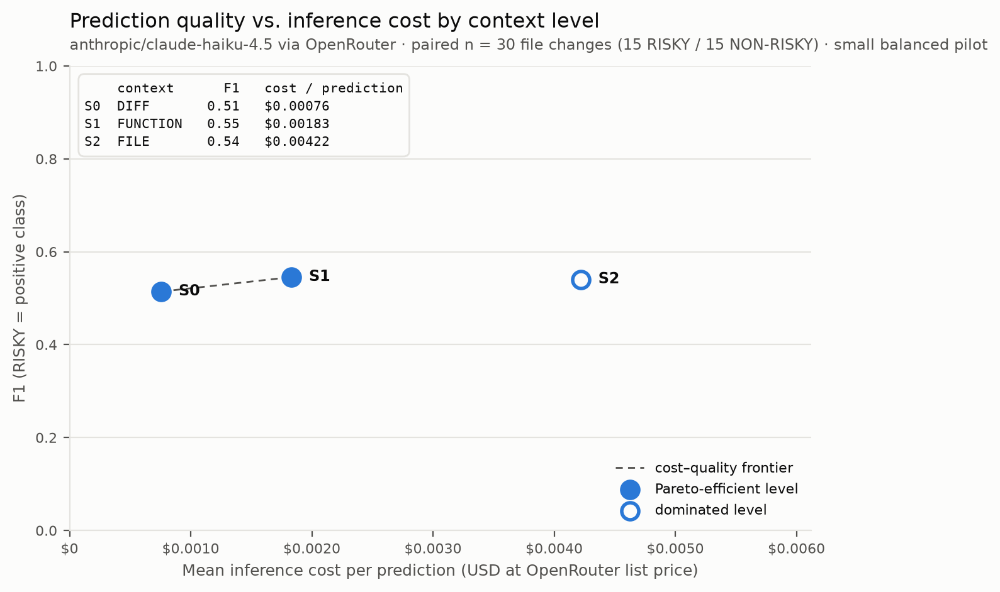

# Context level vs. LLM change-risk prediction — anthropic/claude-haiku-4.5 (small balanced pilot)

_Generated 2026-10-02T08:12:43+00:00 by `experiment.py report`. All numbers are computed from logged API responses._

## Setup

- **Data:** Defectors (Mahbub et al., MSR 2023), JIT split `time/test` (10,000 file changes: 1,246 RISKY / 8,754 NON-RISKY). Label = SZZ-derived defect-line annotation (paper's `induce_bug`, released as column `lines`): nonempty → RISKY, empty → NON-RISKY.
- **Sample:** 15 RISKY + 15 NON-RISKY single-file changes, seed 42, ≤1 file per commit; 249 candidates examined in seeded order, 219 excluded with logged reasons (modified `.py` file, non-merge commit, verified diff, parseable code, edits inside functions, BEFORE+AFTER ≤ 24,000 chars, diff ≤ 8,000 chars).
- **Model:** `anthropic/claude-haiku-4.5` via OpenRouter, provider pinned to `anthropic` (no fallbacks), temperature 0, max_tokens 256, reasoning/thinking disabled; one stateless request per prediction, in seeded random order (90 predictions).
- **Context levels (identical instruction and settings; only the context differs):**
  - **S0 DIFF** — the target-file diff
  - **S1 FUNCTION** — S0 + complete enclosing functions, BEFORE and AFTER
  - **S2 FILE** — S0 + the complete target file, BEFORE and AFTER

## Results (paired set: n = 30 cases with a valid prediction at every level)

| Level | Precision | Recall | F1 | Accuracy | TP / FP / TN / FN | Mean input tokens | Mean output tokens | Mean latency (s) | Mean cost (list price) | Mean charged | Total charged |
|---|---|---|---|---|---|---|---|---|---|---|---|
| S0 DIFF | 0.45 | 0.60 | **0.51** | 0.43 | 9 / 11 / 4 / 6 | 396 | 72.1 | 1.22 | $0.00076 | $0.00076 | $0.0227 |
| S1 FUNCTION | 0.50 | 0.60 | **0.55** | 0.50 | 9 / 9 / 6 / 6 | 1,465 | 73.4 | 1.31 | $0.00183 | $0.00183 | $0.0550 |
| S2 FILE | 0.45 | 0.67 | **0.54** | 0.43 | 10 / 12 / 3 / 5 | 3,845 | 75.0 | 1.45 | $0.00422 | $0.00422 | $0.1266 |

### Trade-off against S0 DIFF

| Level | Cost per prediction | × cost of S0 | F1 [95% CI] | ΔF1 vs S0 [95% CI] | Correct | Fixed / broken vs S0 | Exact McNemar p | Extra cost per extra correct prediction | Pareto-efficient |
|---|---|---|---|---|---|---|---|---|---|
| S0 DIFF | $0.00076 | 1.0× | 0.51 [0.30, 0.70] | +0.00 | 13/30 | 0 / 0 | 1.00 | — | yes |
| S1 FUNCTION | $0.00183 | 2.4× | 0.55 [0.32, 0.73] | +0.03 [-0.10, +0.17] | 15/30 | 3 / 1 | 0.62 | $0.0161 | yes |
| S2 FILE | $0.00422 | 5.6× | 0.54 [0.32, 0.71] | +0.03 [-0.12, +0.18] | 13/30 | 3 / 3 | 1.00 | — | no |

_Trade-off costs use list price (input and output tokens × OpenRouter's per-token price), so that incidental provider-side caching cannot make a level look cheaper; actual charges are under spending._

**Sensitivity — all valid predictions per level** (not restricted to cases valid at every level): S0 F1 0.51 / accuracy 0.43 (n = 30); S1 F1 0.55 / accuracy 0.50 (n = 30); S2 F1 0.54 / accuracy 0.43 (n = 30).

**RQ1 — quality.** F1 by level: S0 0.51, S1 0.55, S2 0.54. Highest: S1 (0.55). Correct predictions: S0 13/30, S1 15/30, S2 13/30. Relative to S0, no level's case-level difference reaches p < 0.05 (exact McNemar); with n = 30 these differences are descriptive, not a statistically established ranking.

**RQ2 — trade-off.** Cost per prediction ranges from $0.00076 (S0) to $0.00422 (S2), a 6× spread driven by input length. Pareto-efficient levels (no other level is at least as good and cheaper): S0, S1; along that frontier S0 → S1: F1 0.51 → 0.55 for 2.4× the cost. Dominated (another level is at least as good for less): S2. The best trade-off is the frontier point where the extra F1 is still worth its extra cost; given the sample size, F1 gaps of one or two cases should not drive that choice on their own.

## Examples where more context changed the outcome

_Correctness is judged only against the reference label; explanations are quoted model output, not evidence._

**case12 — context helped (S2 vs S0).** `home-assistant/core` · `homeassistant/util/unit_conversion.py` · commit `a5b8ec7113` · reference **NON-RISKY**

- S0 DIFF: RISKY ✗ — “Renaming public methods to private (with underscore prefix) breaks the public API and will cause failures for any external code calling these methods directly.”
- S1 FUNCTION: RISKY ✗ — “Renaming public methods to private (with underscore prefix) breaks the public API and will cause runtime errors for any external code calling these methods directly.”
- S2 FILE: NON-RISKY ✓ — “The diff only renames four private helper methods in TemperatureConverter by adding leading underscores (e.g., `celsius_to_fahrenheit` → `_celsius_to_fahrenheit`) and updates all internal call sites consistently, which is a safe refactoring that makes these methods private without changing functionality.”

**case27 — context helped (S2 vs S0).** `getsentry/sentry` · `src/sentry/snuba/metrics_enhanced_performance.py` · commit `4992db3403` · reference **RISKY**

- S0 DIFF: NON-RISKY ✗ — “The change adds a new optional parameter with a default value and passes it through to a downstream function call, which is a straightforward parameter propagation that maintains backward compatibility.”
- S1 FUNCTION: RISKY ✓ — “The new `use_metrics_layer` parameter is added to the function signature and passed to `metrics_query()`, but `metrics_query()` may not accept this parameter, potentially causing a TypeError at runtime.”
- S2 FILE: RISKY ✓ — “The new `use_metrics_layer` parameter is added to the function signature and passed to `metrics_query()`, but the downstream `metrics_query()` function may not accept this parameter, causing a TypeError at runtime.”

**case02 — context hurt (S2 vs S0).** `commaai/openpilot` · `selfdrive/car/car_helpers.py` · commit `7bf70bf7d8` · reference **NON-RISKY**

- S0 DIFF: NON-RISKY ✓ — “The changes add an optional parameter `num_pandas` with a default value to two function signatures and propagate it through the call chain, maintaining backward compatibility while enabling new functionality.”
- S1 FUNCTION: NON-RISKY ✓ — “The changes add a new optional parameter `num_pandas` with a default value of 1 to both `fingerprint()` and `get_car()` functions, and properly thread it through to `get_fw_versions_ordered()`, maintaining backward compatibility while enabling multi-panda support.”
- S2 FILE: RISKY ✗ — “The `fingerprint()` function now requires a `num_pandas` parameter with no default value, which will break all existing callers that don't provide this argument, potentially causing runtime failures in production code.”

## Reference: other models on the same frozen sample

_Each model's own paired set; not a head-to-head test._

| Model | Level | Paired n | F1 | Accuracy | Mean cost |
|---|---|---|---|---|---|
| gemini-2.5-flash-lite | S0 DIFF | 27 | 0.54 | 0.56 | $0.00006 |
| gemini-2.5-flash-lite | S1 FUNCTION | 27 | 0.52 | 0.52 | $0.00017 |
| gemini-2.5-flash-lite | S2 FILE | 27 | 0.50 | 0.56 | $0.00038 |
| gemini-2.5-flash-lite | S3 CALLERS | 27 | 0.35 | 0.44 | $0.00027 |
| gemini-2.5-flash-lite | S4 CALLEES | 27 | 0.40 | 0.44 | $0.00023 |
| gemini-2.5-flash-lite | S5 REPO | 27 | 0.55 | 0.52 | $0.0672 |

## Failures and spending

| Level | Valid | Invalid output | Failed | Not run | Attempts (all) | Charged, all attempts |
|---|---|---|---|---|---|---|
| S0 | 30 | 0 | 0 | 0 | 30 | $0.0227 |
| S1 | 30 | 0 | 0 | 0 | 30 | $0.0550 |
| S2 | 30 | 0 | 0 | 0 | 30 | $0.1266 |

- **Actual charges for this model (OpenRouter `usage.cost`), all 91 logged attempts incl. 1 preflight check(s) and 0 retries: $0.2043.** Attempts with unknown cost: 0. Project total across all models: $10.0215.
- Pre-run estimate (kept separate from charges): $0.2423; worst case $0.4112; project budget cap used by the paid run $3.00.
- Run 20261002T054951Z: key-level usage change $0.130482 vs. sum of per-request charges $0.204316 → NOT reconciled at end of run.
  - Re-check at 2026-10-02T05:52:56+00:00: key-level change $0.204316 → reconciled (the end-of-run check ran before the usage counter caught up).

## Caveats

- **Small balanced pilot** (15 RISKY / 15 NON-RISKY). The split's natural prevalence is about 12% RISKY, so precision in particular does not generalize.
- **Labels are automatically derived** (SZZ-based bug-inducing annotations with heuristic filtering) and can be noisy.
- **Restricted sample:** small files, function-internal edits, single modified files.
- **Both context content and input length change** between levels, so effects cannot be attributed to content alone.
- **No statistically established winner:** differences of a few cases on n = 30 are within sampling noise.
- The repositories are public, so the model may have seen this code during training.

## Files

- `results/claude-haiku-4.5/results.csv` — per-case, per-level predictions joined with labels
- `results/claude-haiku-4.5/summary.csv` — metrics, tokens, latency, cost and trade-off columns per level
- `results/claude-haiku-4.5/cost_vs_f1.png` — cost vs. F1 plot
- `results/claude-haiku-4.5/attempts.jsonl`, `raw/`, `prompts/` — full request/response log
- `data/prepared/manifest.csv`, `selection_log.csv`, `context_summary.json` — frozen sample, exclusions, context coverage
