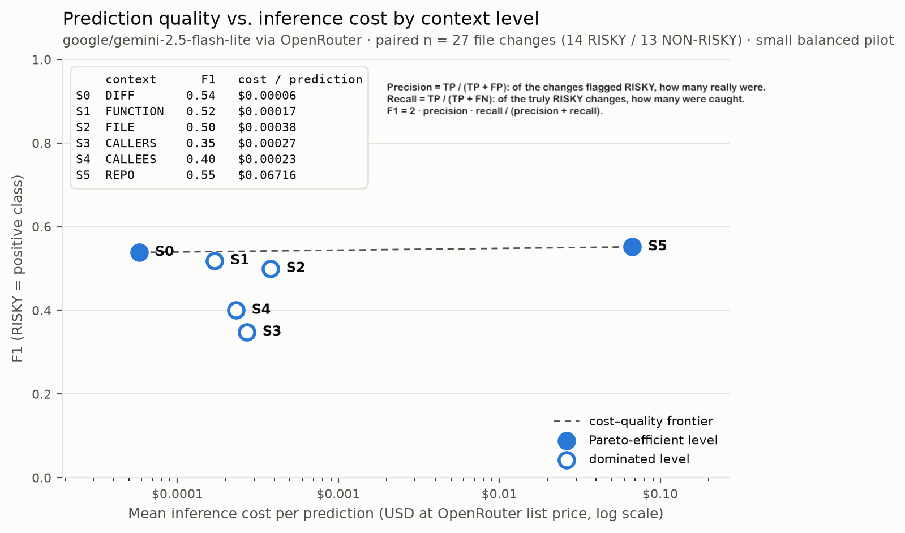

# Context level vs. LLM change-risk prediction — google/gemini-2.5-flash-lite (small balanced pilot)

_Generated 2026-10-02T08:12:42+00:00 by `experiment.py report`. All numbers are computed from logged API responses._

## Setup

- **Data:** Defectors (Mahbub et al., MSR 2023), JIT split `time/test` (10,000 file changes: 1,246 RISKY / 8,754 NON-RISKY). Label = SZZ-derived defect-line annotation (paper's `induce_bug`, released as column `lines`): nonempty → RISKY, empty → NON-RISKY.
- **Sample:** 15 RISKY + 15 NON-RISKY single-file changes, seed 42, ≤1 file per commit; 249 candidates examined in seeded order, 219 excluded with logged reasons (modified `.py` file, non-merge commit, verified diff, parseable code, edits inside functions, BEFORE+AFTER ≤ 24,000 chars, diff ≤ 8,000 chars).
- **Model:** `google/gemini-2.5-flash-lite` via OpenRouter, provider pinned to `google-vertex` (no fallbacks), temperature 0, max_tokens 256, reasoning/thinking disabled; one stateless request per prediction, in seeded random order (180 predictions).
- **Context levels (identical instruction and settings; only the context differs):**
  - **S0 DIFF** — the target-file diff
  - **S1 FUNCTION** — S0 + complete enclosing functions, BEFORE and AFTER
  - **S2 FILE** — S0 + the complete target file, BEFORE and AFTER
  - **S3 CALLERS** — S1 + complete definitions of repository functions that call the changed functions
  - **S4 CALLEES** — S1 + complete definitions of repository functions that the changed functions call
  - **S5 REPO** — S2 + the repository's other Python files at the target commit, nearest to the target file first, whole files only, up to a fixed prompt budget (whole repository when it fits)
- **Context coverage:** callers found for 17/30 cases (median 1 per case; cap of 30 functions / 120,000 chars applied in 0 cases); callees found for 21/30 cases (median 2 per case; cap of 30 functions / 120,000 chars applied in 0 cases); the whole repository fit for 1/30 cases; otherwise a slice (median 13% of the repository's Python files included); S5 prompts averaged 670,972 input tokens, 64% of the model's 1,048,576-token window (budget fixed before the run at 2,500,000 prompt characters so that any tokenizer would fit). Callers/callees come from static `ast` analysis of the repository at the target commit (imports, `self`/`super()`/class calls, module aliases, plus repository-unique names); dynamic dispatch is not resolved.

## Results (paired set: n = 27 cases with a valid prediction at every level)

| Level | Precision | Recall | F1 | Accuracy | TP / FP / TN / FN | Mean input tokens | Mean output tokens | Mean latency (s) | Mean cost (list price) | Mean charged | Total charged |
|---|---|---|---|---|---|---|---|---|---|---|---|
| S0 DIFF | 0.58 | 0.50 | **0.54** | 0.56 | 7 / 5 / 8 / 7 | 378 | 50.6 | 0.72 | $0.00006 | $0.00006 | $0.0016 |
| S1 FUNCTION | 0.54 | 0.50 | **0.52** | 0.52 | 7 / 6 / 7 / 7 | 1,477 | 56.7 | 0.69 | $0.00017 | $0.00017 | $0.0046 |
| S2 FILE | 0.60 | 0.43 | **0.50** | 0.56 | 6 / 4 / 9 / 8 | 3,579 | 53.5 | 0.81 | $0.00038 | $0.00038 | $0.0102 |
| S3 CALLERS | 0.44 | 0.29 | **0.35** | 0.44 | 4 / 5 / 8 / 10 | 2,484 | 53.9 | 0.76 | $0.00027 | $0.00027 | $0.0073 |
| S4 CALLEES | 0.45 | 0.36 | **0.40** | 0.44 | 5 / 6 / 7 / 9 | 2,091 | 54.9 | 0.68 | $0.00023 | $0.00023 | $0.0062 |
| S5 REPO | 0.53 | 0.57 | **0.55** | 0.52 | 8 / 7 / 6 / 6 | 671,354 | 64.1 | 11.53 | $0.0672 | $0.0650 | $1.7547 |

### Trade-off against S0 DIFF

| Level | Cost per prediction | × cost of S0 | F1 [95% CI] | ΔF1 vs S0 [95% CI] | Correct | Fixed / broken vs S0 | Exact McNemar p | Extra cost per extra correct prediction | Pareto-efficient |
|---|---|---|---|---|---|---|---|---|---|
| S0 DIFF | $0.00006 | 1.0× | 0.54 [0.27, 0.74] | +0.00 | 15/27 | 0 / 0 | 1.00 | — | yes |
| S1 FUNCTION | $0.00017 | 2.9× | 0.52 [0.26, 0.71] | -0.02 [-0.25, +0.21] | 14/27 | 2 / 3 | 1.00 | — | no |
| S2 FILE | $0.00038 | 6.5× | 0.50 [0.24, 0.71] | -0.04 [-0.26, +0.16] | 15/27 | 2 / 2 | 1.00 | — | no |
| S3 CALLERS | $0.00027 | 4.7× | 0.35 [0.10, 0.56] | -0.19 [-0.48, +0.07] | 12/27 | 3 / 6 | 0.51 | — | no |
| S4 CALLEES | $0.00023 | 4.0× | 0.40 [0.12, 0.62] | -0.14 [-0.33, +0.00] | 12/27 | 1 / 4 | 0.38 | — | no |
| S5 REPO | $0.0672 | 1157.1× | 0.55 [0.32, 0.75] | +0.01 [-0.17, +0.21] | 14/27 | 3 / 4 | 1.00 | — | yes |

_Trade-off costs use list price (input and output tokens × OpenRouter's per-token price), so that incidental provider-side caching cannot make a level look cheaper; actual charges are under spending._

**Sensitivity — all valid predictions per level** (not restricted to cases valid at every level): S0 F1 0.52 / accuracy 0.57 (n = 30); S1 F1 0.50 / accuracy 0.53 (n = 30); S2 F1 0.48 / accuracy 0.55 (n = 29); S3 F1 0.33 / accuracy 0.47 (n = 30); S4 F1 0.38 / accuracy 0.47 (n = 30); S5 F1 0.55 / accuracy 0.54 (n = 28).

**RQ1 — quality.** F1 by level: S0 0.54, S1 0.52, S2 0.50, S3 0.35, S4 0.40, S5 0.55. Highest: S5 (0.55). Correct predictions: S0 15/27, S1 14/27, S2 15/27, S3 12/27, S4 12/27, S5 14/27. Relative to S0, no level's case-level difference reaches p < 0.05 (exact McNemar); with n = 27 these differences are descriptive, not a statistically established ranking.

**RQ2 — trade-off.** Cost per prediction ranges from $0.00006 (S0) to $0.0672 (S5), a 1157× spread driven by input length. Pareto-efficient levels (no other level is at least as good and cheaper): S0, S5; along that frontier S0 → S5: F1 0.54 → 0.55 for 1157.1× the cost. Dominated (another level is at least as good for less): S1, S2, S3, S4. The best trade-off is the frontier point where the extra F1 is still worth its extra cost; given the sample size, F1 gaps of one or two cases should not drive that choice on their own.

## Examples where more context changed the outcome

_Correctness is judged only against the reference label; explanations are quoted model output, not evidence._

**case02 — context helped (S5 vs S0).** `commaai/openpilot` · `selfdrive/car/car_helpers.py` · commit `7bf70bf7d8` · reference **NON-RISKY**

- S0 DIFF: RISKY ✗ — “The `fingerprint` function now accepts an additional `num_pandas` argument, but this change is not propagated to the `get_car` function's signature, potentially leading to unexpected behavior or errors when `get_car` is called without this argument.”
- S1 FUNCTION: RISKY ✗ — “The `fingerprint` function now accepts a `num_pandas` argument, which is passed to `get_fw_versions_ordered`, potentially altering the firmware version retrieval logic and impacting car identification.”
- S2 FILE: NON-RISKY ✓ — “The `fingerprint` function now accepts an optional `num_pandas` argument, which is correctly passed to `get_fw_versions_ordered`, ensuring compatibility with multi-panda setups without altering existing functionality for single-panda systems.”
- S3 CALLERS: NON-RISKY ✓ — “The `fingerprint` function now accepts an optional `num_pandas` argument, which is correctly passed to `get_fw_versions_ordered`, improving multi-panda support without altering existing single-panda functionality.”
- S4 CALLEES: NON-RISKY ✓ — “The `fingerprint` function now accepts an optional `num_pandas` argument, which is correctly passed to `get_fw_versions_ordered`, ensuring compatibility with multi-panda setups without altering existing functionality for single-panda configurations.”
- S5 REPO: NON-RISKY ✓ — “The change introduces a new argument `num_pandas` to the `fingerprint` function and passes it to `get_fw_versions_ordered`, which is a non-functional change that does not alter the existing behavior or logic.”

**case27 — context helped (S5 vs S0).** `getsentry/sentry` · `src/sentry/snuba/metrics_enhanced_performance.py` · commit `4992db3403` · reference **RISKY**

- S0 DIFF: NON-RISKY ✗ — “The change adds a new optional parameter `use_metrics_layer` to the `query` function, which is not used within the provided diff and therefore does not introduce new behavior or potential defects.”
- S1 FUNCTION: RISKY ✓ — “A new parameter `use_metrics_layer` has been added to the `query` function and passed to `metrics_query` without a default value, which could lead to errors if not provided.”
- S2 FILE: RISKY ✓ — “A new parameter `use_metrics_layer` was added to the `query` function and passed to `metrics_query` without a default value, which could lead to errors if not provided by callers.”
- S3 CALLERS: RISKY ✓ — “A new parameter `use_metrics_layer` has been added to the `query` function and passed to `metrics_query` without a default value, which could lead to errors if not handled by callers.”
- S4 CALLEES: NON-RISKY ✗ — “A new optional parameter `use_metrics_layer` is added to the `query` function and passed to `metrics_query`, which is a safe addition as it does not alter existing behavior for callers who do not provide the new parameter.”
- S5 REPO: RISKY ✓ — “The `use_metrics_layer` parameter was added to the `metrics_query` call without any logic to control its value, potentially leading to unexpected behavior or defects if the underlying `metrics_query` function relies on this parameter.”

**case06 — context hurt (S5 vs S0).** `ray-project/ray` · `python/ray/workflow/workflow_state_from_dag.py` · commit `4a1ad3e87a` · reference **NON-RISKY**

- S0 DIFF: NON-RISKY ✓ — “The change removes a TODO comment and a redundant validation for `max_retries`, which is already handled by Ray's options system, and adds `retry_exceptions` to `WorkflowStepRuntimeOptions`.”
- S1 FUNCTION: NON-RISKY ✓ — “The change removes a redundant validation for 'max_retries' and adds a new 'retry_exceptions' parameter to WorkflowStepRuntimeOptions, which is a safe addition as it only introduces new functionality without altering existing logic.”
- S2 FILE: NON-RISKY ✓ — “The change removes a redundant validation for `max_retries` and adds `retry_exceptions` to `WorkflowStepRuntimeOptions`, which is a safe addition as it only introduces a new configurable option without altering existing logic.”
- S3 CALLERS: NON-RISKY ✓ — “The change removes redundant validation for `max_retries` and adds `retry_exceptions` to `WorkflowStepRuntimeOptions`, which are minor additions that do not alter core functionality or introduce new risks.”
- S4 CALLEES: NON-RISKY ✓ — “The change removes a redundant validation for `max_retries` and adds `retry_exceptions` to `WorkflowStepRuntimeOptions`, which are minor adjustments to existing functionality and do not introduce new behavior that could cause defects.”
- S5 REPO: RISKY ✗ — “The diff removes the validation check for `max_retries` which was previously ensuring that it was an integer and within the acceptable range of -1, 0, or positive integers.”

## Reference: other models on the same frozen sample

_Each model's own paired set; not a head-to-head test._

| Model | Level | Paired n | F1 | Accuracy | Mean cost |
|---|---|---|---|---|---|
| claude-haiku-4.5 | S0 DIFF | 30 | 0.51 | 0.43 | $0.00076 |
| claude-haiku-4.5 | S1 FUNCTION | 30 | 0.55 | 0.50 | $0.00183 |
| claude-haiku-4.5 | S2 FILE | 30 | 0.54 | 0.43 | $0.00422 |

## Failures and spending

| Level | Valid | Invalid output | Failed | Not run | Attempts (all) | Charged, all attempts |
|---|---|---|---|---|---|---|
| S0 | 30 | 0 | 0 | 0 | 30 | $0.0017 |
| S1 | 30 | 0 | 0 | 0 | 30 | $0.0048 |
| S2 | 29 | 1 | 0 | 0 | 30 | $0.0115 |
| S3 | 30 | 0 | 0 | 0 | 30 | $0.0075 |
| S4 | 30 | 0 | 0 | 0 | 30 | $0.0065 |
| S5 | 28 | 2 | 0 | 0 | 31 | $1.9551 |

- **Actual charges for this model (OpenRouter `usage.cost`), all 182 logged attempts incl. 1 preflight check(s) and 1 retry: $1.9871.** Attempts with unknown cost: 1. Project total across all models: $10.0215.
- 1 request(s) were billed partly at the provider's cache-read rate (case01/S5: 651,250 cached tokens), e.g. when a retry re-sent an identical prompt; charges include that discount, list-price costs do not.
- Pre-run estimate (kept separate from charges): $2.5379; worst case $3.8145; project budget cap used by the paid run $8.00.
- Run 20261002T063748Z: key-level usage change $1.987120 vs. sum of per-request charges $1.987120 → reconciled at end of run.

## Caveats

- **Small balanced pilot** (15 RISKY / 15 NON-RISKY). The split's natural prevalence is about 12% RISKY, so precision in particular does not generalize.
- **Labels are automatically derived** (SZZ-based bug-inducing annotations with heuristic filtering) and can be noisy.
- **Restricted sample:** small files, function-internal edits, single modified files.
- **Both context content and input length change** between levels, so effects cannot be attributed to content alone.
- **No statistically established winner:** differences of a few cases on n = 27 are within sampling noise.
- **"Entire repository" is only literal where it fits:** most repositories (0.7M–15M tokens of Python) exceed any available context window, so S5 is a nearest-first slice under a budget fixed before the run (see context coverage for the share of files and of the window it used).
- **Callers/callees are static approximations:** framework callbacks and dynamically dispatched calls are missed; S3/S4 fall back to S1 content plus an explicit "none found" note in those cases.
- The repositories are public, so the model may have seen this code during training.

## Files

- `results/gemini-2.5-flash-lite/results.csv` — per-case, per-level predictions joined with labels
- `results/gemini-2.5-flash-lite/summary.csv` — metrics, tokens, latency, cost and trade-off columns per level
- `results/gemini-2.5-flash-lite/cost_vs_f1.png` — cost vs. F1 plot
- `results/gemini-2.5-flash-lite/attempts.jsonl`, `raw/`, `prompts/` — full request/response log
- `data/prepared/manifest.csv`, `selection_log.csv`, `context_summary.json` — frozen sample, exclusions, context coverage
