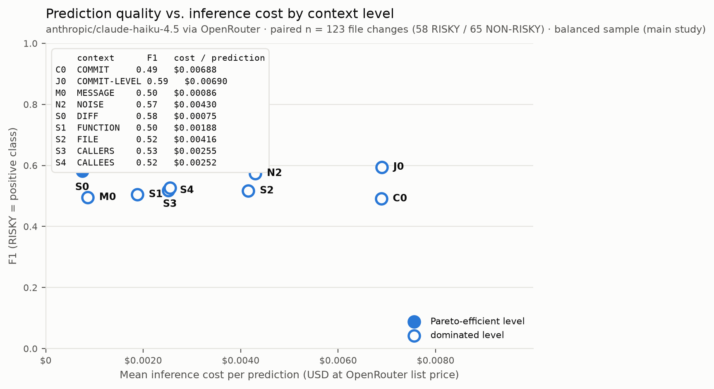

# Context level vs. LLM change-risk prediction — anthropic/claude-haiku-4.5 (balanced sample, main study)

_Generated 2026-11-25T00:13:45+00:00 by `experiment.py report`. All numbers are computed from logged API responses._

## Setup

- **Data:** Defectors (Mahbub et al., MSR 2023), JIT split `time/test` (10,000 file changes: 1,246 RISKY / 8,754 NON-RISKY). Label = SZZ-derived defect-line annotation (paper's `induce_bug`, released as column `lines`): nonempty → RISKY, empty → NON-RISKY.
- **Sample:** 73 RISKY + 73 NON-RISKY single-file changes, seed 42, ≤1 file per commit; 1731 candidates examined in seeded order, 1585 excluded with logged reasons (modified `.py` file, non-merge commit, verified diff, parseable code, edits inside functions, BEFORE+AFTER ≤ 24,000 chars, diff ≤ 8,000 chars).
- **Model:** `anthropic/claude-haiku-4.5` via OpenRouter, provider pinned to `anthropic` (no fallbacks), temperature 0, max_tokens 256, reasoning/thinking disabled; one stateless request per prediction, in seeded random order (1314 predictions).
- **Context levels (identical instruction and settings; only the context differs):**
  - **S0 DIFF** — the target-file diff
  - **S1 FUNCTION** — S0 + complete enclosing functions, BEFORE and AFTER
  - **S2 FILE** — S0 + the complete target file, BEFORE and AFTER
  - **S3 CALLERS** — S1 + complete definitions of repository functions that call the changed functions
  - **S4 CALLEES** — S1 + complete definitions of repository functions that the changed functions call
  - **N2 NOISE** — control: S0 + Python files from a different repository, cut to the number of characters S2 adds to S0 (same length as S2, no information about the change)
  - **M0 MESSAGE** — S0 + the target commit's message, verbatim
  - **C0 COMMIT** — S0 + the diffs of the other files changed by the target commit (same question about the target file)
  - **J0 COMMIT-LEVEL** — the whole commit diff, all files, with the question asked about the commit instead of the target file
- **Context coverage:** callers found for 73/146 cases (median 0 per case; cap of 30 functions / 120,000 chars applied in 0 cases); callees found for 111/146 cases (median 2 per case; cap of 30 functions / 120,000 chars applied in 0 cases). Callers/callees come from static `ast` analysis of the repository at the target commit (imports, `self`/`super()`/class calls, module aliases, plus repository-unique names); dynamic dispatch is not resolved.

## Results (paired set: n = 123 cases with a valid prediction at every level)

| Level | Precision | Recall | F1 | Accuracy | TP / FP / TN / FN | Mean input tokens | Mean output tokens | Mean latency (s) | Mean cost (list price) | Mean charged | Total charged |
|---|---|---|---|---|---|---|---|---|---|---|---|
| S0 DIFF | 0.58 | 0.59 | **0.58** | 0.60 | 34 / 25 / 40 / 24 | 396 | 70.5 | 1.15 | $0.00075 | $0.00075 | $0.0921 |
| S1 FUNCTION | 0.53 | 0.48 | **0.50** | 0.55 | 28 / 25 / 40 / 30 | 1,506 | 74.5 | 1.26 | $0.00188 | $0.00188 | $0.2310 |
| S2 FILE | 0.50 | 0.53 | **0.52** | 0.53 | 31 / 31 / 34 / 27 | 3,771 | 77.3 | 1.41 | $0.00416 | $0.00416 | $0.5114 |
| S3 CALLERS | 0.54 | 0.52 | **0.53** | 0.56 | 30 / 26 / 39 / 28 | 2,170 | 75.8 | 1.28 | $0.00255 | $0.00255 | $0.3135 |
| S4 CALLEES | 0.54 | 0.50 | **0.52** | 0.56 | 29 / 25 / 40 / 29 | 2,131 | 77.4 | 1.32 | $0.00252 | $0.00252 | $0.3097 |
| N2 NOISE | 0.55 | 0.60 | **0.57** | 0.58 | 35 / 29 / 36 / 23 | 3,918 | 76.9 | 1.44 | $0.00430 | $0.00430 | $0.5292 |
| M0 MESSAGE | 0.58 | 0.43 | **0.50** | 0.59 | 25 / 18 / 47 / 33 | 494 | 73.3 | 1.22 | $0.00086 | $0.00086 | $0.1059 |
| C0 COMMIT | 0.54 | 0.45 | **0.49** | 0.56 | 26 / 22 / 43 / 32 | 6,479 | 81.2 | 1.54 | $0.00688 | $0.00688 | $0.8468 |
| J0 COMMIT-LEVEL | 0.51 | 0.71 | **0.59** | 0.54 | 41 / 39 / 26 / 17 | 6,461 | 87.0 | 1.61 | $0.00690 | $0.00690 | $0.8483 |

### Trade-off against S0 DIFF

| Level | Cost per prediction | × cost of S0 | F1 [95% CI] | ΔF1 vs S0 [95% CI] | Correct | Fixed / broken vs S0 | Exact McNemar p | Extra cost per extra correct prediction | Pareto-efficient |
|---|---|---|---|---|---|---|---|---|---|
| S0 DIFF | $0.00075 | 1.0× | 0.58 [0.46, 0.68] | +0.00 | 74/123 | 0 / 0 | 1.00 | — | yes |
| S1 FUNCTION | $0.00188 | 2.5× | 0.50 [0.38, 0.61] | -0.08 [-0.17, +0.01] | 68/123 | 7 / 13 | 0.26 | — | no |
| S2 FILE | $0.00416 | 5.6× | 0.52 [0.40, 0.62] | -0.06 [-0.16, +0.02] | 65/123 | 7 / 16 | 0.09 | — | no |
| S3 CALLERS | $0.00255 | 3.4× | 0.53 [0.41, 0.63] | -0.05 [-0.14, +0.03] | 69/123 | 9 / 14 | 0.40 | — | no |
| S4 CALLEES | $0.00252 | 3.4× | 0.52 [0.40, 0.63] | -0.06 [-0.14, +0.01] | 69/123 | 8 / 13 | 0.38 | — | no |
| N2 NOISE | $0.00430 | 5.7× | 0.57 [0.46, 0.67] | -0.01 [-0.09, +0.08] | 71/123 | 10 / 13 | 0.68 | — | no |
| M0 MESSAGE | $0.00086 | 1.1× | 0.50 [0.37, 0.60] | -0.09 [-0.18, +0.00] | 72/123 | 11 / 13 | 0.84 | — | no |
| C0 COMMIT | $0.00688 | 9.2× | 0.49 [0.36, 0.60] | -0.09 [-0.20, +0.02] | 69/123 | 12 / 17 | 0.46 | — | no |
| J0 COMMIT-LEVEL | $0.00690 | 9.2× | 0.59 [0.49, 0.68] | +0.01 [-0.08, +0.11] | 67/123 | 13 / 20 | 0.30 | — | no |

_Trade-off costs use list price (input and output tokens × OpenRouter's per-token price), so that incidental provider-side caching cannot make a level look cheaper; actual charges are under spending._

**Sensitivity — all valid predictions per level** (not restricted to cases valid at every level): S0 F1 0.60 / accuracy 0.60 (n = 144); S1 F1 0.52 / accuracy 0.54 (n = 144); S2 F1 0.54 / accuracy 0.53 (n = 145); S3 F1 0.56 / accuracy 0.56 (n = 142); S4 F1 0.54 / accuracy 0.56 (n = 143); N2 F1 0.62 / accuracy 0.60 (n = 134); M0 F1 0.52 / accuracy 0.58 (n = 144); C0 F1 0.52 / accuracy 0.58 (n = 141); J0 F1 0.64 / accuracy 0.57 (n = 145).

**RQ1 — quality.** F1 by level: S0 0.58, S1 0.50, S2 0.52, S3 0.53, S4 0.52, N2 0.57, M0 0.50, C0 0.49, J0 0.59. Highest: J0 (0.59). Correct predictions: S0 74/123, S1 68/123, S2 65/123, S3 69/123, S4 69/123, N2 71/123, M0 72/123, C0 69/123, J0 67/123. Relative to S0, no level's case-level difference reaches p < 0.05 (exact McNemar); with n = 123 these differences are descriptive, not a statistically established ranking.

**RQ2 — trade-off.** Cost per prediction ranges from $0.00075 (S0) to $0.00690 (J0), a 9× spread driven by input length. Pareto-efficient levels (no other level is at least as good and cheaper): S0. Dominated (another level is at least as good for less): S1, S2, S3, S4, N2, M0, C0, J0. The best trade-off is the frontier point where the extra F1 is still worth its extra cost; given the sample size, F1 gaps of one or two cases should not drive that choice on their own.

## Examples where more context changed the outcome

_Correctness is judged only against the reference label; explanations are quoted model output, not evidence._

**case008 — context helped (S4 vs S0).** `Lightning-AI/lightning` · `src/lightning_lite/strategies/parallel.py` · commit `d15bd1520e` · reference **NON-RISKY**

- S0 DIFF: RISKY ✗ — “Renaming the parameter from `precision_plugin` to `precision` changes the public API signature, which will break any code calling this method with the old parameter name.”
- S1 FUNCTION: RISKY ✗ — “Renaming the parameter from `precision_plugin` to `precision` is a breaking API change that will cause any code calling this method with the old parameter name to fail.”
- S2 FILE: RISKY ✗ — “The parameter rename from `precision_plugin` to `precision` changes the public API signature, which will break any code calling this constructor with the old parameter name.”
- S3 CALLERS: NON-RISKY ✓ — “The parameter rename from `precision_plugin` to `precision` is consistently applied across the parent class and all three subclasses (DDPStrategy, DDPSpawnStrategy, DataParallelStrategy), maintaining API compatibility throughout the inheritance hierarchy.”
- S4 CALLEES: NON-RISKY ✓ — “The parameter rename from `precision_plugin` to `precision` in `ParallelStrategy.__init__` is consistent with the parent class `Strategy.__init__` which already uses the `precision` parameter name, ensuring correct argument passing to the superclass.”
- N2 NOISE: RISKY ✗ — “The parameter name change from `precision_plugin` to `precision` in the function signature and super().__init__() call may break compatibility if parent class or callers still expect the old parameter name.”
- M0 MESSAGE: NON-RISKY ✓ — “This is a parameter rename refactoring that updates both the method signature and the super() call consistently, maintaining functional equivalence while aligning with a broader API standardization effort.”
- C0 COMMIT: NON-RISKY ✓ — “The change is a systematic parameter rename from `precision_plugin` to `precision` across the codebase, which is a refactoring that maintains functional equivalence by consistently updating all call sites, method signatures, and internal references.”
- J0 COMMIT-LEVEL: NON-RISKY ✓ — “This commit performs a systematic rename of `precision_plugin` to `precision` throughout the codebase, which is a refactoring that maintains functional equivalence by consistently updating all references, property names, variable names, and method signatures without altering the underlying logic or behavior.”

**case009 — context helped (S4 vs S0).** `getsentry/sentry` · `src/sentry/api/endpoints/organization_projects.py` · commit `7b063776de` · reference **NON-RISKY**

- S0 DIFF: RISKY ✗ — “The condition `if expand_context:` will always be True since `expand_context` is a non-empty dictionary with a 'options' key, causing 'options' to always be added to expand regardless of whether options were actually requested.”
- S1 FUNCTION: RISKY ✗ — “The condition `if expand_context:` will always be True since a non-empty dictionary is always truthy, making the logic incorrect—it should check if the options list is non-empty instead.”
- S2 FILE: RISKY ✗ — “The condition `if expand_context:` will always be True since a non-empty dictionary is always truthy, making the logic flawed—it should check if the options list is non-empty instead, and the expand_context parameter is passed to ProjectSummarySerializer without verification that it accepts this parameter.”
- S3 CALLERS: NON-RISKY ✓ — “The change adds optional expand_context parameter extraction and passes it to ProjectSummarySerializer, which is a safe additive change that only affects behavior when the 'options' query parameter is explicitly provided.”
- S4 CALLEES: NON-RISKY ✓ — “The change adds support for an 'options' query parameter by creating an expand_context dictionary and passing it to ProjectSummarySerializer, which already accepts this parameter in its __init__ method, making this a safe feature addition with no breaking changes.”
- N2 NOISE: NON-RISKY ✓ — “The change adds a new `expand_context` parameter to the serializer with a safe default empty list, and only adds 'options' to the expand set when the context is non-empty, which is a straightforward feature addition with no logic errors or side effects.”
- M0 MESSAGE: RISKY ✗ — “The code always adds 'options' to the expand set when expand_context is truthy, but expand_context is initialized as a dict that will always be truthy even when the options list is empty, causing unintended expansion behavior.”
- C0 COMMIT: NON-RISKY ✓ — “The change adds a new optional `expand_context` parameter to pass user-requested options through the serializer, with proper validation that filters options against a safe whitelist (OPTION_KEYS), preventing injection of arbitrary project options.”
- J0 COMMIT-LEVEL: RISKY ✗ — “The code has a logic error where `expand_context` is checked with `if expand_context:` but should check if the 'options' key exists, and the `get_options` method will fail with AttributeError when `self.expand_context` is None since it calls `.get()` on a potentially None value.”

**case011 — context hurt (S4 vs S0).** `localstack/localstack` · `localstack/services/dynamodb/utils.py` · commit `0331772540` · reference **RISKY**

- S0 DIFF: RISKY ✓ — “The error message was shortened, which may break tests or client code that expect the full AWS-formatted error message including the operation name and error code prefix.”
- S1 FUNCTION: NON-RISKY ✗ — “The change only simplifies the error message text by removing the operation context prefix, which does not affect the functional behavior of the code since the exception is still raised with a valid error message.”
- S2 FILE: RISKY ✓ — “The error message was shortened, removing context about the operation (BatchWriteItem) and error type prefix, which may break error message matching in tests or client code that expects the full AWS-formatted error message.”
- S3 CALLERS: RISKY ✓ — “The error message was shortened from a detailed AWS-formatted message to a generic one, which may break error message matching in tests or client code that expects the original AWS BatchWriteItem operation context in the exception message.”
- S4 CALLEES: NON-RISKY ✗ — “The change only simplifies the error message text without altering the exception type, control flow, or functional behavior of the code.”
- N2 NOISE: NON-RISKY ✗ — “The change simplifies an error message by removing redundant prefix text ('An error occurred (ValidationException) when calling the BatchWriteItem operation:') while preserving the core validation message, which does not alter the functional behavior or exception handling logic.”
- M0 MESSAGE: RISKY ✓ — “The error message was shortened, removing the operation context ('BatchWriteItem operation') and error prefix, which may break tests or code that validates the exact error message format.”
- C0 COMMIT: NON-RISKY ✗ — “The error message simplification removes redundant prefix text while preserving the core validation message, and the snapshot test confirms the new message format is expected and correct.”
- J0 COMMIT-LEVEL: RISKY ✓ — “The commit changes error messages in production code (e.g., 'Cannot create preexisting table' to 'Table already exists: {table_name}' and simplifies a validation error message), which could break existing error handling logic that depends on exact error message matching.”

## Reference: other models on the same frozen sample

_Each model's own paired set; not a head-to-head test._

| Model | Level | Paired n | F1 | Accuracy | Mean cost |
|---|---|---|---|---|---|
| claude-haiku-4.5_rep2 | S0 DIFF | 145 | 0.61 | 0.60 | $0.00075 |
| claude-haiku-4.5_rep2 | S2 FILE | 145 | 0.55 | 0.54 | $0.00427 |
| claude-sonnet-4.6 | S0 DIFF | 136 | 0.52 | 0.54 | $0.00221 |
| claude-sonnet-4.6 | S1 FUNCTION | 136 | 0.58 | 0.58 | $0.00560 |
| claude-sonnet-4.6 | S2 FILE | 136 | 0.60 | 0.61 | $0.0128 |
| claude-sonnet-4.6 | S3 CALLERS | 136 | 0.58 | 0.59 | $0.00770 |
| claude-sonnet-4.6 | S4 CALLEES | 136 | 0.57 | 0.58 | $0.00747 |
| claude-sonnet-4.6 | N2 NOISE | 136 | 0.60 | 0.60 | $0.0133 |
| claude-sonnet-4.6 | M0 MESSAGE | 136 | 0.56 | 0.60 | $0.00247 |
| claude-sonnet-4.6 | C0 COMMIT | 136 | 0.57 | 0.59 | $0.0201 |
| claude-sonnet-4.6 | J0 COMMIT-LEVEL | 136 | 0.66 | 0.60 | $0.0201 |
| claude-sonnet-4.6_rep2 | S0 DIFF | 144 | 0.54 | 0.57 | $0.00223 |
| claude-sonnet-4.6_rep2 | S2 FILE | 144 | 0.61 | 0.61 | $0.0128 |
| gemini-2.5-flash-lite | S0 DIFF | 137 | 0.53 | 0.60 | $0.00006 |
| gemini-2.5-flash-lite | S1 FUNCTION | 137 | 0.48 | 0.55 | $0.00016 |
| gemini-2.5-flash-lite | S2 FILE | 137 | 0.39 | 0.53 | $0.00038 |
| gemini-2.5-flash-lite | S3 CALLERS | 137 | 0.43 | 0.53 | $0.00023 |
| gemini-2.5-flash-lite | S4 CALLEES | 137 | 0.46 | 0.55 | $0.00023 |
| gemini-2.5-flash-lite | S5 REPO | 137 | 0.53 | 0.53 | $0.0665 |
| gemini-2.5-flash-lite_ai-studio | S0 DIFF | 142 | 0.50 | 0.61 | $0.00005 |
| gemini-2.5-flash-lite_ai-studio | S1 FUNCTION | 142 | 0.47 | 0.57 | $0.00016 |
| gemini-2.5-flash-lite_ai-studio | S2 FILE | 142 | 0.41 | 0.56 | $0.00039 |
| gemini-2.5-flash-lite_ai-studio | S3 CALLERS | 142 | 0.41 | 0.54 | $0.00023 |
| gemini-2.5-flash-lite_ai-studio | S4 CALLEES | 142 | 0.41 | 0.54 | $0.00023 |
| gemini-2.5-flash-lite_ai-studio | N2 NOISE | 142 | 0.49 | 0.54 | $0.00040 |
| gemini-2.5-flash-lite_ai-studio | M0 MESSAGE | 142 | 0.33 | 0.56 | $0.00006 |
| gemini-2.5-flash-lite_ai-studio | C0 COMMIT | 142 | 0.48 | 0.55 | $0.00062 |
| gemini-2.5-flash-lite_ai-studio | J0 COMMIT-LEVEL | 142 | 0.59 | 0.59 | $0.00062 |
| gemini-2.5-flash-lite_ai-studio_rep2 | S0 DIFF | 146 | 0.49 | 0.60 | $0.00006 |
| gemini-2.5-flash-lite_ai-studio_rep2 | S2 FILE | 146 | 0.40 | 0.55 | $0.00039 |
| qwen3.8-flash | S0 DIFF | 126 | 0.56 | 0.53 | $0.00008 |
| qwen3.8-flash | S1 FUNCTION | 126 | 0.59 | 0.59 | $0.00022 |
| qwen3.8-flash | S2 FILE | 126 | 0.56 | 0.55 | $0.00051 |
| qwen3.8-flash | S3 CALLERS | 126 | 0.57 | 0.57 | $0.00031 |
| qwen3.8-flash | S4 CALLEES | 126 | 0.60 | 0.60 | $0.00031 |
| qwen3.8-flash | N2 NOISE | 126 | 0.60 | 0.61 | $0.00053 |
| qwen3.8-flash | M0 MESSAGE | 126 | 0.58 | 0.58 | $0.00009 |
| qwen3.8-flash | C0 COMMIT | 126 | 0.52 | 0.54 | $0.00081 |
| qwen3.8-flash | J0 COMMIT-LEVEL | 126 | 0.66 | 0.58 | $0.00081 |
| qwen3.8-flash_rep2 | S0 DIFF | 143 | 0.59 | 0.54 | $0.00007 |
| qwen3.8-flash_rep2 | S2 FILE | 143 | 0.59 | 0.55 | $0.00051 |

## Failures and spending

| Level | Valid | Invalid output | Failed | Not run | Attempts (all) | Charged, all attempts |
|---|---|---|---|---|---|---|
| S0 | 144 | 2 | 0 | 0 | 116 | $0.0870 |
| S1 | 144 | 2 | 0 | 0 | 116 | $0.2204 |
| S2 | 145 | 1 | 0 | 0 | 116 | $0.4958 |
| S3 | 142 | 4 | 0 | 0 | 146 | $0.3757 |
| S4 | 143 | 3 | 0 | 0 | 146 | $0.3726 |
| N2 | 134 | 12 | 0 | 0 | 146 | $0.6514 |
| M0 | 144 | 2 | 0 | 0 | 146 | $0.1256 |
| C0 | 141 | 5 | 0 | 0 | 146 | $0.9721 |
| J0 | 145 | 1 | 0 | 0 | 146 | $0.9700 |

- **Actual charges for this model (OpenRouter `usage.cost`), all 1227 logged attempts incl. 3 preflight check(s) and 0 retries: $4.2708.** Attempts with unknown cost: 0. Project total across all models: $31.6556.
- 90 predictions were reused from earlier runs of the identical request (same prompt, model and settings hash), originally charged $0.2043; they were not requested or charged again.
- Pre-run estimate (kept separate from charges): $2.0019; worst case $3.1575; project budget cap used by the paid run $33.00.
- Run 20261119T000135Z: key-level usage change $2.202934 vs. sum of per-request charges $2.202934 → reconciled at end of run.
- Run 20261120T151736Z: key-level usage change $0.125659 vs. sum of per-request charges $0.125659 → reconciled at end of run.
- Run 20261124T235115Z: key-level usage change $1.942160 vs. sum of per-request charges $1.942160 → reconciled at end of run.

## Caveats

- **Balanced sample** (73 RISKY / 73 NON-RISKY). The split's natural prevalence is about 12% RISKY, so precision in particular does not generalize.
- **Labels are automatically derived** (SZZ-based bug-inducing annotations with heuristic filtering) and can be noisy.
- **Restricted sample:** small files, function-internal edits, single modified files.
- **Both context content and input length change** between levels, so effects cannot be attributed to content alone.
- **No statistically established winner:** differences of a few cases on n = 123 are within sampling noise.
- **Callers/callees are static approximations:** framework callbacks and dynamically dispatched calls are missed; S3/S4 fall back to S1 content plus an explicit "none found" note in those cases.
- The repositories are public, so the model may have seen this code during training.

## Files

- `results/main/claude-haiku-4.5/results.csv` — per-case, per-level predictions joined with labels
- `results/main/claude-haiku-4.5/summary.csv` — metrics, tokens, latency, cost and trade-off columns per level
- `results/main/claude-haiku-4.5/cost_vs_f1.png` — cost vs. F1 plot
- `results/main/claude-haiku-4.5/attempts.jsonl`, `raw/`, `prompts/` — full request/response log
- `data/prepared/manifest.csv`, `selection_log.csv`, `context_summary.json` — frozen sample, exclusions, context coverage
