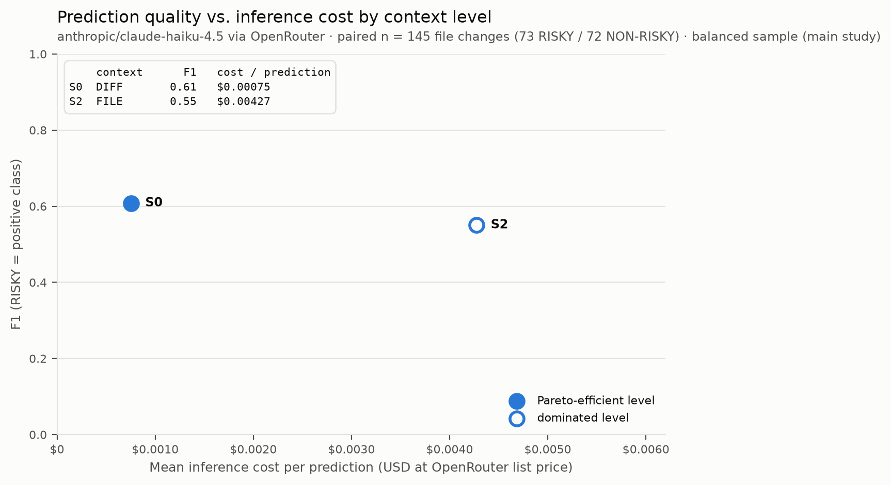

# Context level vs. LLM change-risk prediction — anthropic/claude-haiku-4.5 (balanced sample, main study, identical re-run #2)

_Generated 2026-11-19T00:39:57+00:00 by `experiment.py report`. All numbers are computed from logged API responses._

## Setup

- **Data:** Defectors (Mahbub et al., MSR 2023), JIT split `time/test` (10,000 file changes: 1,246 RISKY / 8,754 NON-RISKY). Label = SZZ-derived defect-line annotation (paper's `induce_bug`, released as column `lines`): nonempty → RISKY, empty → NON-RISKY.
- **Sample:** 73 RISKY + 73 NON-RISKY single-file changes, seed 42, ≤1 file per commit; 1731 candidates examined in seeded order, 1585 excluded with logged reasons (modified `.py` file, non-merge commit, verified diff, parseable code, edits inside functions, BEFORE+AFTER ≤ 24,000 chars, diff ≤ 8,000 chars).
- **Model:** `anthropic/claude-haiku-4.5` via OpenRouter, provider pinned to `anthropic` (no fallbacks), temperature 0, max_tokens 256, reasoning/thinking disabled; one stateless request per prediction, in seeded random order (292 predictions).
- **Context levels (identical instruction and settings; only the context differs):**
  - **S0 DIFF** — the target-file diff
  - **S2 FILE** — S0 + the complete target file, BEFORE and AFTER

## Results (paired set: n = 145 cases with a valid prediction at every level)

| Level | Precision | Recall | F1 | Accuracy | TP / FP / TN / FN | Mean input tokens | Mean output tokens | Mean latency (s) | Mean cost (list price) | Mean charged | Total charged |
|---|---|---|---|---|---|---|---|---|---|---|---|
| S0 DIFF | 0.60 | 0.62 | **0.61** | 0.60 | 45 / 30 / 42 / 28 | 395 | 71.4 | 1.22 | $0.00075 | $0.00075 | $0.1091 |
| S2 FILE | 0.54 | 0.56 | **0.55** | 0.54 | 41 / 35 / 37 / 32 | 3,885 | 77.6 | 1.42 | $0.00427 | $0.00427 | $0.6196 |

### Trade-off against S0 DIFF

| Level | Cost per prediction | × cost of S0 | F1 [95% CI] | ΔF1 vs S0 [95% CI] | Correct | Fixed / broken vs S0 | Exact McNemar p | Extra cost per extra correct prediction | Pareto-efficient |
|---|---|---|---|---|---|---|---|---|---|
| S0 DIFF | $0.00075 | 1.0× | 0.61 [0.51, 0.69] | +0.00 | 87/145 | 0 / 0 | 1.00 | — | yes |
| S2 FILE | $0.00427 | 5.7× | 0.55 [0.45, 0.64] | -0.06 [-0.13, +0.02] | 78/145 | 8 / 17 | 0.11 | — | no |

_Trade-off costs use list price (input and output tokens × OpenRouter's per-token price), so that incidental provider-side caching cannot make a level look cheaper; actual charges are under spending._

**Sensitivity — all valid predictions per level** (not restricted to cases valid at every level): S0 F1 0.61 / accuracy 0.60 (n = 145); S2 F1 0.55 / accuracy 0.54 (n = 145).

**RQ1 — quality.** F1 by level: S0 0.61, S2 0.55. Highest: S0 (0.61). Correct predictions: S0 87/145, S2 78/145. Relative to S0, no level's case-level difference reaches p < 0.05 (exact McNemar); with n = 145 these differences are descriptive, not a statistically established ranking.

**RQ2 — trade-off.** Cost per prediction ranges from $0.00075 (S0) to $0.00427 (S2), a 6× spread driven by input length. Pareto-efficient levels (no other level is at least as good and cheaper): S0. Dominated (another level is at least as good for less): S2. The best trade-off is the frontier point where the extra F1 is still worth its extra cost; given the sample size, F1 gaps of one or two cases should not drive that choice on their own.

## Examples where more context changed the outcome

_Correctness is judged only against the reference label; explanations are quoted model output, not evidence._

**case012 — context helped (S2 vs S0).** `home-assistant/core` · `homeassistant/util/unit_conversion.py` · commit `a5b8ec7113` · reference **NON-RISKY**

- S0 DIFF: RISKY ✗ — “Renaming public methods to private (with underscore prefix) breaks the public API and will cause failures for any external code calling these methods directly.”
- S2 FILE: NON-RISKY ✓ — “The diff only renames four private helper methods in TemperatureConverter by adding underscore prefixes (making them explicitly private), and updates all internal call sites consistently, with no changes to logic or external API.”

**case037 — context helped (S2 vs S0).** `apache/airflow` · `airflow/providers/google/cloud/hooks/video_intelligence.py` · commit `6e66dd7776` · reference **NON-RISKY**

- S0 DIFF: RISKY ✗ — “Changing from `self._get_credentials()` to `self.get_credentials()` alters the method call scope and may fail if the parent class method signature differs or if `get_credentials()` is not properly inherited.”
- S2 FILE: NON-RISKY ✓ — “The change replaces a private method `_get_credentials()` with the public method `get_credentials()` from the parent `GoogleBaseHook` class, which is a standard refactoring pattern that maintains the same functionality while using the proper public API.”

**case002 — context hurt (S2 vs S0).** `commaai/openpilot` · `selfdrive/car/car_helpers.py` · commit `7bf70bf7d8` · reference **NON-RISKY**

- S0 DIFF: NON-RISKY ✓ — “The changes add an optional parameter `num_pandas` with a default value to two function signatures and propagate it through the call chain, maintaining backward compatibility while enabling new functionality.”
- S2 FILE: RISKY ✗ — “The `fingerprint()` function now requires a `num_pandas` parameter with no default value, which will break all existing callers that don't provide this argument, potentially causing runtime failures in production code.”

## Reference: other models on the same frozen sample

_Each model's own paired set; not a head-to-head test._

| Model | Level | Paired n | F1 | Accuracy | Mean cost |
|---|---|---|---|---|---|
| claude-haiku-4.5 | S0 DIFF | 129 | 0.61 | 0.61 | $0.00075 |
| claude-haiku-4.5 | S1 FUNCTION | 129 | 0.53 | 0.56 | $0.00186 |
| claude-haiku-4.5 | S2 FILE | 129 | 0.55 | 0.54 | $0.00416 |
| claude-haiku-4.5 | S3 CALLERS | 129 | 0.56 | 0.57 | $0.00252 |
| claude-haiku-4.5 | S4 CALLEES | 129 | 0.55 | 0.57 | $0.00249 |
| claude-haiku-4.5 | N2 NOISE | 129 | 0.60 | 0.59 | $0.00430 |
| gemini-2.5-flash-lite | S0 DIFF | 137 | 0.53 | 0.60 | $0.00006 |
| gemini-2.5-flash-lite | S1 FUNCTION | 137 | 0.48 | 0.55 | $0.00016 |
| gemini-2.5-flash-lite | S2 FILE | 137 | 0.39 | 0.53 | $0.00038 |
| gemini-2.5-flash-lite | S3 CALLERS | 137 | 0.43 | 0.53 | $0.00023 |
| gemini-2.5-flash-lite | S4 CALLEES | 137 | 0.46 | 0.55 | $0.00023 |
| gemini-2.5-flash-lite | S5 REPO | 137 | 0.53 | 0.53 | $0.0665 |
| gemini-2.5-flash-lite_ai-studio | S0 DIFF | 146 | 0.49 | 0.60 | $0.00006 |
| gemini-2.5-flash-lite_ai-studio | S1 FUNCTION | 146 | 0.46 | 0.57 | $0.00016 |
| gemini-2.5-flash-lite_ai-studio | S2 FILE | 146 | 0.40 | 0.55 | $0.00039 |
| gemini-2.5-flash-lite_ai-studio | S3 CALLERS | 146 | 0.41 | 0.54 | $0.00023 |
| gemini-2.5-flash-lite_ai-studio | S4 CALLEES | 146 | 0.41 | 0.54 | $0.00023 |
| gemini-2.5-flash-lite_ai-studio | N2 NOISE | 146 | 0.48 | 0.53 | $0.00040 |
| gemini-2.5-flash-lite_ai-studio_rep2 | S0 DIFF | 146 | 0.49 | 0.60 | $0.00006 |
| gemini-2.5-flash-lite_ai-studio_rep2 | S2 FILE | 146 | 0.40 | 0.55 | $0.00039 |

## Failures and spending

| Level | Valid | Invalid output | Failed | Not run | Attempts (all) | Charged, all attempts |
|---|---|---|---|---|---|---|
| S0 | 145 | 1 | 0 | 0 | 146 | $0.1097 |
| S2 | 145 | 1 | 0 | 0 | 146 | $0.6220 |

- **Actual charges for this model (OpenRouter `usage.cost`), all 293 logged attempts incl. 1 preflight check(s) and 0 retries: $0.7317.** Attempts with unknown cost: 0. Project total across all models: $13.2174.
- Pre-run estimate (kept separate from charges): $0.8614; worst case $1.4468; project budget cap used by the paid run $16.00.
- Run 20261119T002019Z: key-level usage change $0.731712 vs. sum of per-request charges $0.731712 → reconciled at end of run.

## Caveats

- **Balanced sample** (73 RISKY / 73 NON-RISKY). The split's natural prevalence is about 12% RISKY, so precision in particular does not generalize.
- **Labels are automatically derived** (SZZ-based bug-inducing annotations with heuristic filtering) and can be noisy.
- **Restricted sample:** small files, function-internal edits, single modified files.
- **Both context content and input length change** between levels, so effects cannot be attributed to content alone.
- **No statistically established winner:** differences of a few cases on n = 145 are within sampling noise.
- The repositories are public, so the model may have seen this code during training.

## Files

- `results/main/claude-haiku-4.5_rep2/results.csv` — per-case, per-level predictions joined with labels
- `results/main/claude-haiku-4.5_rep2/summary.csv` — metrics, tokens, latency, cost and trade-off columns per level
- `results/main/claude-haiku-4.5_rep2/cost_vs_f1.png` — cost vs. F1 plot
- `results/main/claude-haiku-4.5_rep2/attempts.jsonl`, `raw/`, `prompts/` — full request/response log
- `data/prepared/manifest.csv`, `selection_log.csv`, `context_summary.json` — frozen sample, exclusions, context coverage
