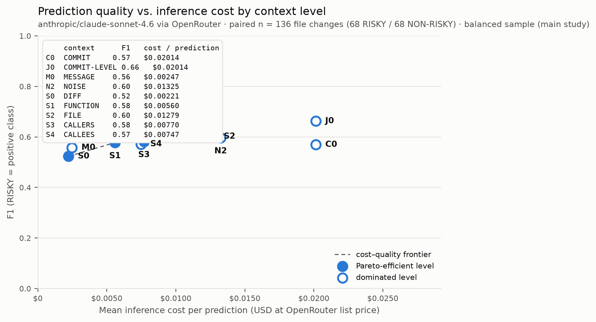

# Context level vs. LLM change-risk prediction — anthropic/claude-sonnet-4.6 (balanced sample, main study)

_Generated 2026-11-25T00:13:46+00:00 by `experiment.py report`. All numbers are computed from logged API responses._

## Setup

- **Data:** Defectors (Mahbub et al., MSR 2023), JIT split `time/test` (10,000 file changes: 1,246 RISKY / 8,754 NON-RISKY). Label = SZZ-derived defect-line annotation (paper's `induce_bug`, released as column `lines`): nonempty → RISKY, empty → NON-RISKY.
- **Sample:** 73 RISKY + 73 NON-RISKY single-file changes, seed 42, ≤1 file per commit; 1731 candidates examined in seeded order, 1585 excluded with logged reasons (modified `.py` file, non-merge commit, verified diff, parseable code, edits inside functions, BEFORE+AFTER ≤ 24,000 chars, diff ≤ 8,000 chars).
- **Model:** `anthropic/claude-sonnet-4.6` via OpenRouter, provider pinned to `anthropic` (no fallbacks), temperature 0, max_tokens 256, reasoning/thinking disabled; one stateless request per prediction, in seeded random order (1314 predictions).
- **Context levels (identical instruction and settings; only the context differs):**
  - **S0 DIFF** — the target-file diff
  - **S1 FUNCTION** — S0 + complete enclosing functions, BEFORE and AFTER
  - **S2 FILE** — S0 + the complete target file, BEFORE and AFTER
  - **S3 CALLERS** — S1 + complete definitions of repository functions that call the changed functions
  - **S4 CALLEES** — S1 + complete definitions of repository functions that the changed functions call
  - **N2 NOISE** — control: S0 + Python files from a different repository, cut to the number of characters S2 adds to S0 (same length as S2, no information about the change)
  - **M0 MESSAGE** — S0 + the target commit's message, verbatim
  - **C0 COMMIT** — S0 + the diffs of the other files changed by the target commit (same question about the target file)
  - **J0 COMMIT-LEVEL** — the whole commit diff, all files, with the question asked about the commit instead of the target file
- **Context coverage:** callers found for 73/146 cases (median 0 per case; cap of 30 functions / 120,000 chars applied in 0 cases); callees found for 111/146 cases (median 2 per case; cap of 30 functions / 120,000 chars applied in 0 cases). Callers/callees come from static `ast` analysis of the repository at the target commit (imports, `self`/`super()`/class calls, module aliases, plus repository-unique names); dynamic dispatch is not resolved.

## Results (paired set: n = 136 cases with a valid prediction at every level)

| Level | Precision | Recall | F1 | Accuracy | TP / FP / TN / FN | Mean input tokens | Mean output tokens | Mean latency (s) | Mean cost (list price) | Mean charged | Total charged |
|---|---|---|---|---|---|---|---|---|---|---|---|
| S0 DIFF | 0.55 | 0.50 | **0.52** | 0.54 | 34 / 28 / 40 / 34 | 398 | 68.0 | 2.50 | $0.00221 | $0.00221 | $0.3012 |
| S1 FUNCTION | 0.58 | 0.57 | **0.58** | 0.58 | 39 / 28 / 40 / 29 | 1,508 | 71.5 | 2.67 | $0.00560 | $0.00560 | $0.7612 |
| S2 FILE | 0.62 | 0.59 | **0.60** | 0.61 | 40 / 25 / 43 / 28 | 3,891 | 74.2 | 3.00 | $0.0128 | $0.0128 | $1.7389 |
| S3 CALLERS | 0.59 | 0.57 | **0.58** | 0.59 | 39 / 27 / 41 / 29 | 2,206 | 72.0 | 2.82 | $0.00770 | $0.00770 | $1.0468 |
| S4 CALLEES | 0.58 | 0.56 | **0.57** | 0.58 | 38 / 27 / 41 / 30 | 2,107 | 76.2 | 2.95 | $0.00747 | $0.00747 | $1.0152 |
| N2 NOISE | 0.61 | 0.59 | **0.60** | 0.60 | 40 / 26 / 42 / 28 | 4,053 | 72.9 | 3.15 | $0.0133 | $0.0133 | $1.8025 |
| M0 MESSAGE | 0.63 | 0.50 | **0.56** | 0.60 | 34 / 20 / 48 / 34 | 497 | 65.5 | 2.40 | $0.00247 | $0.00247 | $0.3364 |
| C0 COMMIT | 0.60 | 0.54 | **0.57** | 0.59 | 37 / 25 / 43 / 31 | 6,304 | 82.0 | 2.62 | $0.0201 | $0.0201 | $2.7394 |
| J0 COMMIT-LEVEL | 0.58 | 0.78 | **0.66** | 0.60 | 53 / 39 / 29 / 15 | 6,286 | 85.3 | 2.71 | $0.0201 | $0.0201 | $2.7387 |

### Trade-off against S0 DIFF

| Level | Cost per prediction | × cost of S0 | F1 [95% CI] | ΔF1 vs S0 [95% CI] | Correct | Fixed / broken vs S0 | Exact McNemar p | Extra cost per extra correct prediction | Pareto-efficient |
|---|---|---|---|---|---|---|---|---|---|
| S0 DIFF | $0.00221 | 1.0× | 0.52 [0.41, 0.62] | +0.00 | 74/136 | 0 / 0 | 1.00 | — | yes |
| S1 FUNCTION | $0.00560 | 2.5× | 0.58 [0.47, 0.67] | +0.05 [-0.01, +0.12] | 79/136 | 10 / 5 | 0.30 | $0.0920 | yes |
| S2 FILE | $0.0128 | 5.8× | 0.60 [0.49, 0.70] | +0.08 [+0.01, +0.16] | 83/136 | 15 / 6 | 0.08 | $0.1597 | yes |
| S3 CALLERS | $0.00770 | 3.5× | 0.58 [0.48, 0.68] | +0.06 [-0.01, +0.13] | 80/136 | 11 / 5 | 0.21 | $0.1243 | yes |
| S4 CALLEES | $0.00747 | 3.4× | 0.57 [0.46, 0.66] | +0.05 [-0.03, +0.13] | 79/136 | 12 / 7 | 0.36 | $0.1428 | no |
| N2 NOISE | $0.0133 | 6.0× | 0.60 [0.49, 0.69] | +0.07 [+0.00, +0.15] | 82/136 | 14 / 6 | 0.12 | $0.1877 | no |
| M0 MESSAGE | $0.00247 | 1.1× | 0.56 [0.44, 0.66] | +0.03 [-0.04, +0.11] | 82/136 | 13 / 5 | 0.10 | $0.00441 | no |
| C0 COMMIT | $0.0201 | 9.1× | 0.57 [0.46, 0.66] | +0.05 [-0.04, +0.14] | 80/136 | 16 / 10 | 0.33 | $0.4064 | no |
| J0 COMMIT-LEVEL | $0.0201 | 9.1× | 0.66 [0.57, 0.74] | +0.14 [+0.04, +0.24] | 82/136 | 26 / 18 | 0.29 | $0.3047 | no |

_Trade-off costs use list price (input and output tokens × OpenRouter's per-token price), so that incidental provider-side caching cannot make a level look cheaper; actual charges are under spending._

**Sensitivity — all valid predictions per level** (not restricted to cases valid at every level): S0 F1 0.55 / accuracy 0.56 (n = 144); S1 F1 0.60 / accuracy 0.59 (n = 141); S2 F1 0.61 / accuracy 0.61 (n = 144); S3 F1 0.60 / accuracy 0.60 (n = 141); S4 F1 0.57 / accuracy 0.58 (n = 143); N2 F1 0.61 / accuracy 0.61 (n = 145); M0 F1 0.58 / accuracy 0.61 (n = 144); C0 F1 0.56 / accuracy 0.59 (n = 141); J0 F1 0.67 / accuracy 0.61 (n = 145).

**RQ1 — quality.** F1 by level: S0 0.52, S1 0.58, S2 0.60, S3 0.58, S4 0.57, N2 0.60, M0 0.56, C0 0.57, J0 0.66. Highest: J0 (0.66). Correct predictions: S0 74/136, S1 79/136, S2 83/136, S3 80/136, S4 79/136, N2 82/136, M0 82/136, C0 80/136, J0 82/136. Relative to S0, no level's case-level difference reaches p < 0.05 (exact McNemar); with n = 136 these differences are descriptive, not a statistically established ranking.

**RQ2 — trade-off.** Cost per prediction ranges from $0.00221 (S0) to $0.0201 (C0), a 9× spread driven by input length. Pareto-efficient levels (no other level is at least as good and cheaper): S0, S1, S3, S2; along that frontier S0 → S1: F1 0.52 → 0.58 for 2.5× the cost; S1 → S3: F1 0.58 → 0.58 for 1.4× the cost; S3 → S2: F1 0.58 → 0.60 for 1.7× the cost. Dominated (another level is at least as good for less): S4, N2, M0, C0, J0. The best trade-off is the frontier point where the extra F1 is still worth its extra cost; given the sample size, F1 gaps of one or two cases should not drive that choice on their own.

## Examples where more context changed the outcome

_Correctness is judged only against the reference label; explanations are quoted model output, not evidence._

**case013 — context helped (S4 vs S0).** `Lightning-AI/lightning` · `src/lightning_app/utilities/commands/base.py` · commit `4acb10f981` · reference **RISKY**

- S0 DIFF: NON-RISKY ✗ — “The change only adds description metadata (from docstrings or DESCRIPTION attribute) to commands and OpenAPI extras, without altering any control flow or data processing logic.”
- S1 FUNCTION: RISKY ✓ — “Setting `self.DESCRIPTION` in `__init__` mutates the class-level attribute when `DESCRIPTION` is falsy, meaning the first instantiation with a docstring will permanently change `DESCRIPTION` for all subsequent instances of that class, causing unexpected shared state.”
- S2 FILE: RISKY ✓ — “In `ClientCommand.__init__`, accessing `self.method.__doc__` when `method=None` (as done in `_download_command`) will raise an `AttributeError`, crashing command downloads.”
- S3 CALLERS: RISKY ✓ — “Setting `self.DESCRIPTION = self.method.__doc__ or ""` mutates the class-level attribute on the `ClientCommand` class itself (not an instance attribute) when `DESCRIPTION` is falsy, meaning the first instantiation with a docstring could permanently override `DESCRIPTION` for all subsequent instances of that class.”
- S4 CALLEES: RISKY ✓ — “Setting `self.DESCRIPTION` as an instance attribute mutates what may be a class-level variable, meaning if `DESCRIPTION` is falsy on the class, the first instantiation will set it on the instance but subsequent instantiations could still see the class-level falsy value rather than the previously set instance value, and more critically, assigning to `self.DESCRIPTION` when it is a class attribute could shadow or unexpectedly modify shared state across instances depending on the class definition.”
- N2 NOISE: NON-RISKY ✗ — “The change simply populates DESCRIPTION from the method's docstring when not already set, and adds description fields to the OpenAPI extras dict, which are additive metadata changes with no impact on core command execution logic.”
- M0 MESSAGE: NON-RISKY ✗ — “The change only adds description metadata collection from docstrings and the DESCRIPTION attribute, with no impact on command execution logic or control flow.”
- C0 COMMIT: RISKY ✓ — “The `_list_app_commands` function now calls `_get_commands_metadata()` which opens `.meta.json` unconditionally, but if the file doesn't exist (e.g., older connected app without the metadata file), it will raise a `FileNotFoundError` instead of gracefully listing or reporting no commands.”
- J0 COMMIT-LEVEL: RISKY ✓ — “The `_list_app_commands` function now depends on `_get_commands_metadata()` reading a `.meta.json` file, but if that file doesn't exist (e.g., connected with an older version or the file is missing), it will raise an unhandled exception instead of gracefully listing commands.”

**case042 — context helped (S4 vs S0).** `ray-project/ray` · `doc/source/ray-air/doc_code/tf_starter.py` · commit `a29baf93c8` · reference **NON-RISKY**

- S0 DIFF: RISKY ✗ — “Changing `input_shape=(1,)` to `input_shape=()` alters the expected input from a 2D tensor of shape (batch_size, 1) to a scalar/1D tensor, and while the added `Flatten()` layer is intended to compensate, this changes the model's input contract and may cause shape mismatches or silent behavioral differences depending on how data is fed to the model.”
- S1 FUNCTION: NON-RISKY ✓ — “The change adapts the model to accept scalar inputs (shape `()`) and uses `Flatten` to expand them to `(batch_size, 1)`, which is functionally equivalent to the previous `input_shape=(1,)` approach and correctly handles the intended input format.”
- S2 FILE: NON-RISKY ✓ — “The change replaces `InputLayer(input_shape=(1,))` with `InputLayer(input_shape=()) + Flatten()`, which is functionally equivalent for scalar inputs and aligns with the actual data shape `(None, 1)` produced by `to_tf`, making the model more robust rather than introducing a defect.”
- S3 CALLERS: RISKY ✗ — “The caller uses `output_signature=(tf.TensorSpec(shape=(None, 1), ...)` producing tensors of shape `(batch_size, 1)`, but the new `InputLayer(input_shape=())` expects scalar inputs `(batch_size,)`, creating a shape mismatch that will cause a runtime error.”
- S4 CALLEES: NON-RISKY ✓ — “The change adapts the model to accept scalar inputs (shape `()`) and uses `Flatten` to expand them to `(batch_size, 1)`, which is functionally equivalent to the previous `input_shape=(1,)` approach and correctly handles the intended input format.”
- N2 NOISE: NON-RISKY ✓ — “The change updates the model input shape from (1,) to () and adds a Flatten layer to expand scalar inputs to the expected (batch_size, 1) shape, which is a valid documentation/example fix with no functional defect introduced.”
- M0 MESSAGE: NON-RISKY ✓ — “The change adjusts the InputLayer shape from (1,) to () and adds a Flatten layer to handle scalar inputs, which is a documentation/example code fix to match the new iter_tf_batches() API that returns scalar-shaped tensors rather than 1D tensors.”
- C0 COMMIT: RISKY ✗ — “Changing `InputLayer(input_shape=(1,))` to `InputLayer(input_shape=())` with a `Flatten()` layer reflects the broader refactor that removes the automatic `tf.expand_dims` in the predictor, but if any code path still passes a 1D tensor without going through `Flatten` (e.g., direct model calls outside the trainer), the Dense layer will receive a scalar-per-sample input instead of a (batch, 1) tensor, causing shape mismatches.”
- J0 COMMIT-LEVEL: RISKY ✗ — “The old `_array_to_tensor` implementations automatically unsqueezed 1-D tensors to (batch_size, 1) before passing them to the model, but the new `_arrays_to_tensors` implementations remove this automatic unsqueeze, meaning any existing model that relied on that behavior (and wasn't updated in this commit) will receive incorrectly shaped tensors and likely fail or produce wrong results.”

**case008 — context hurt (S4 vs S0).** `Lightning-AI/lightning` · `src/lightning_lite/strategies/parallel.py` · commit `d15bd1520e` · reference **NON-RISKY**

- S0 DIFF: NON-RISKY ✓ — “This change is a straightforward parameter rename from `precision_plugin` to `precision` that is consistently applied in both the method signature and the `super().__init__()` call, with no logic changes.”
- S1 FUNCTION: RISKY ✗ — “Renaming the parameter from `precision_plugin` to `precision` is a breaking API change that will cause any existing callers passing `precision_plugin` as a keyword argument to silently receive the default `None` instead of their intended value.”
- S2 FILE: RISKY ✗ — “Renaming the parameter from `precision_plugin` to `precision` is a breaking API change that will cause failures in any subclasses or callers that pass `precision_plugin` as a keyword argument to `ParallelStrategy.__init__`.”
- S3 CALLERS: NON-RISKY ✓ — “This is a straightforward parameter rename from `precision_plugin` to `precision` that is consistently applied in both the method signature and the super().__init__() call, and all callers already use the new `precision` keyword argument.”
- S4 CALLEES: RISKY ✗ — “Renaming the parameter from `precision_plugin` to `precision` is a breaking API change for any callers that pass the argument by keyword name (e.g., `ParallelStrategy(precision_plugin=...)`), which will now raise a TypeError at runtime.”
- N2 NOISE: NON-RISKY ✓ — “The change simply renames the `precision_plugin` parameter to `precision` in `ParallelStrategy.__init__` and passes it through to `super().__init__`, which is a consistent rename that mirrors the same parameter rename in the parent `Strategy` class.”
- M0 MESSAGE: RISKY ✗ — “Renaming the constructor parameter from `precision_plugin` to `precision` is a breaking API change that will cause errors for any existing callers passing `precision_plugin` as a keyword argument to `ParallelStrategy` or its subclasses.”
- C0 COMMIT: NON-RISKY ✓ — “This change is a consistent rename of the `precision_plugin` parameter to `precision` in `ParallelStrategy.__init__`, matching the same rename applied uniformly across all other strategy classes and the base `Strategy` class in the same commit.”
- J0 COMMIT-LEVEL: NON-RISKY ✓ — “This commit is a pure rename refactoring that consistently replaces `precision_plugin` with `precision` (and related internal variable names like `_precision_plugin_flag`→`_precision_instance`, `_precision_flag`→`_precision_input`) across all files, with no changes to logic or behavior.”

## Reference: other models on the same frozen sample

_Each model's own paired set; not a head-to-head test._

| Model | Level | Paired n | F1 | Accuracy | Mean cost |
|---|---|---|---|---|---|
| claude-haiku-4.5 | S0 DIFF | 123 | 0.58 | 0.60 | $0.00075 |
| claude-haiku-4.5 | S1 FUNCTION | 123 | 0.50 | 0.55 | $0.00188 |
| claude-haiku-4.5 | S2 FILE | 123 | 0.52 | 0.53 | $0.00416 |
| claude-haiku-4.5 | S3 CALLERS | 123 | 0.53 | 0.56 | $0.00255 |
| claude-haiku-4.5 | S4 CALLEES | 123 | 0.52 | 0.56 | $0.00252 |
| claude-haiku-4.5 | N2 NOISE | 123 | 0.57 | 0.58 | $0.00430 |
| claude-haiku-4.5 | M0 MESSAGE | 123 | 0.50 | 0.59 | $0.00086 |
| claude-haiku-4.5 | C0 COMMIT | 123 | 0.49 | 0.56 | $0.00688 |
| claude-haiku-4.5 | J0 COMMIT-LEVEL | 123 | 0.59 | 0.54 | $0.00690 |
| claude-haiku-4.5_rep2 | S0 DIFF | 145 | 0.61 | 0.60 | $0.00075 |
| claude-haiku-4.5_rep2 | S2 FILE | 145 | 0.55 | 0.54 | $0.00427 |
| claude-sonnet-4.6_rep2 | S0 DIFF | 144 | 0.54 | 0.57 | $0.00223 |
| claude-sonnet-4.6_rep2 | S2 FILE | 144 | 0.61 | 0.61 | $0.0128 |
| gemini-2.5-flash-lite | S0 DIFF | 137 | 0.53 | 0.60 | $0.00006 |
| gemini-2.5-flash-lite | S1 FUNCTION | 137 | 0.48 | 0.55 | $0.00016 |
| gemini-2.5-flash-lite | S2 FILE | 137 | 0.39 | 0.53 | $0.00038 |
| gemini-2.5-flash-lite | S3 CALLERS | 137 | 0.43 | 0.53 | $0.00023 |
| gemini-2.5-flash-lite | S4 CALLEES | 137 | 0.46 | 0.55 | $0.00023 |
| gemini-2.5-flash-lite | S5 REPO | 137 | 0.53 | 0.53 | $0.0665 |
| gemini-2.5-flash-lite_ai-studio | S0 DIFF | 142 | 0.50 | 0.61 | $0.00005 |
| gemini-2.5-flash-lite_ai-studio | S1 FUNCTION | 142 | 0.47 | 0.57 | $0.00016 |
| gemini-2.5-flash-lite_ai-studio | S2 FILE | 142 | 0.41 | 0.56 | $0.00039 |
| gemini-2.5-flash-lite_ai-studio | S3 CALLERS | 142 | 0.41 | 0.54 | $0.00023 |
| gemini-2.5-flash-lite_ai-studio | S4 CALLEES | 142 | 0.41 | 0.54 | $0.00023 |
| gemini-2.5-flash-lite_ai-studio | N2 NOISE | 142 | 0.49 | 0.54 | $0.00040 |
| gemini-2.5-flash-lite_ai-studio | M0 MESSAGE | 142 | 0.33 | 0.56 | $0.00006 |
| gemini-2.5-flash-lite_ai-studio | C0 COMMIT | 142 | 0.48 | 0.55 | $0.00062 |
| gemini-2.5-flash-lite_ai-studio | J0 COMMIT-LEVEL | 142 | 0.59 | 0.59 | $0.00062 |
| gemini-2.5-flash-lite_ai-studio_rep2 | S0 DIFF | 146 | 0.49 | 0.60 | $0.00006 |
| gemini-2.5-flash-lite_ai-studio_rep2 | S2 FILE | 146 | 0.40 | 0.55 | $0.00039 |
| qwen3.8-flash | S0 DIFF | 126 | 0.56 | 0.53 | $0.00008 |
| qwen3.8-flash | S1 FUNCTION | 126 | 0.59 | 0.59 | $0.00022 |
| qwen3.8-flash | S2 FILE | 126 | 0.56 | 0.55 | $0.00051 |
| qwen3.8-flash | S3 CALLERS | 126 | 0.57 | 0.57 | $0.00031 |
| qwen3.8-flash | S4 CALLEES | 126 | 0.60 | 0.60 | $0.00031 |
| qwen3.8-flash | N2 NOISE | 126 | 0.60 | 0.61 | $0.00053 |
| qwen3.8-flash | M0 MESSAGE | 126 | 0.58 | 0.58 | $0.00009 |
| qwen3.8-flash | C0 COMMIT | 126 | 0.52 | 0.54 | $0.00081 |
| qwen3.8-flash | J0 COMMIT-LEVEL | 126 | 0.66 | 0.58 | $0.00081 |
| qwen3.8-flash_rep2 | S0 DIFF | 143 | 0.59 | 0.54 | $0.00007 |
| qwen3.8-flash_rep2 | S2 FILE | 143 | 0.59 | 0.55 | $0.00051 |

## Failures and spending

| Level | Valid | Invalid output | Failed | Not run | Attempts (all) | Charged, all attempts |
|---|---|---|---|---|---|---|
| S0 | 144 | 2 | 0 | 0 | 146 | $0.3300 |
| S1 | 141 | 5 | 0 | 0 | 146 | $0.8351 |
| S2 | 144 | 2 | 0 | 0 | 146 | $1.8674 |
| S3 | 141 | 5 | 0 | 0 | 146 | $1.1297 |
| S4 | 143 | 3 | 0 | 0 | 146 | $1.1203 |
| N2 | 145 | 1 | 0 | 0 | 146 | $1.9243 |
| M0 | 144 | 2 | 0 | 0 | 146 | $0.3671 |
| C0 | 141 | 5 | 0 | 0 | 146 | $2.9204 |
| J0 | 145 | 1 | 0 | 0 | 146 | $2.9107 |

- **Actual charges for this model (OpenRouter `usage.cost`), all 1316 logged attempts incl. 2 preflight check(s) and 0 retries: $13.4053.** Attempts with unknown cost: 0. Project total across all models: $31.6556.
- Pre-run estimate (kept separate from charges): $6.0056; worst case $9.4725; project budget cap used by the paid run $33.00.
- Run 20261120T160630Z: key-level usage change $7.573998 vs. sum of per-request charges $7.573998 → reconciled at end of run.
- Run 20261124T235939Z: key-level usage change $5.831304 vs. sum of per-request charges $5.831304 → reconciled at end of run.

## Caveats

- **Balanced sample** (73 RISKY / 73 NON-RISKY). The split's natural prevalence is about 12% RISKY, so precision in particular does not generalize.
- **Labels are automatically derived** (SZZ-based bug-inducing annotations with heuristic filtering) and can be noisy.
- **Restricted sample:** small files, function-internal edits, single modified files.
- **Both context content and input length change** between levels, so effects cannot be attributed to content alone.
- **No statistically established winner:** differences of a few cases on n = 136 are within sampling noise.
- **Callers/callees are static approximations:** framework callbacks and dynamically dispatched calls are missed; S3/S4 fall back to S1 content plus an explicit "none found" note in those cases.
- The repositories are public, so the model may have seen this code during training.

## Files

- `results/main/claude-sonnet-4.6/results.csv` — per-case, per-level predictions joined with labels
- `results/main/claude-sonnet-4.6/summary.csv` — metrics, tokens, latency, cost and trade-off columns per level
- `results/main/claude-sonnet-4.6/cost_vs_f1.png` — cost vs. F1 plot
- `results/main/claude-sonnet-4.6/attempts.jsonl`, `raw/`, `prompts/` — full request/response log
- `data/prepared/manifest.csv`, `selection_log.csv`, `context_summary.json` — frozen sample, exclusions, context coverage
