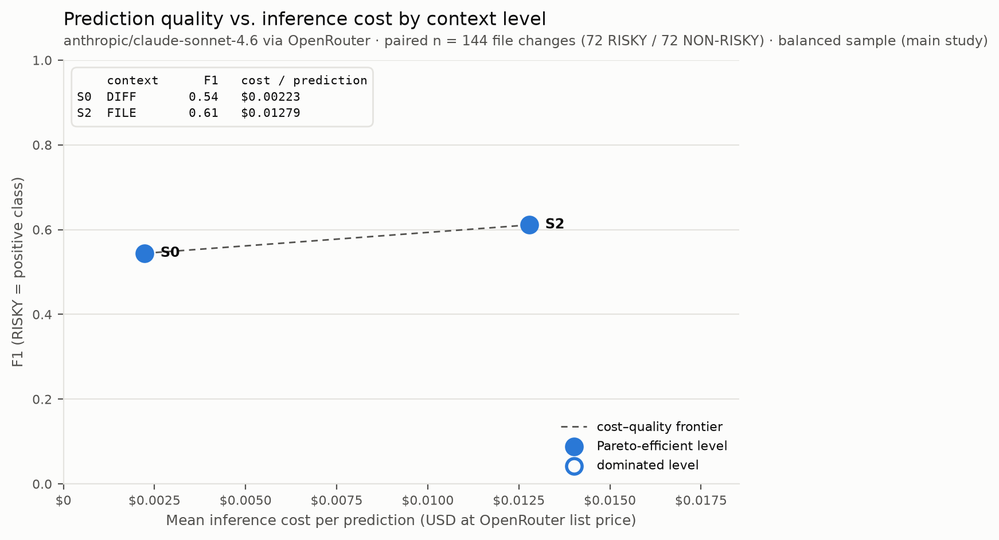

# Context level vs. LLM change-risk prediction — anthropic/claude-sonnet-4.6 (balanced sample, main study, identical re-run #2)

_Generated 2026-11-20T17:11:05+00:00 by `experiment.py report`. All numbers are computed from logged API responses._

## Setup

- **Data:** Defectors (Mahbub et al., MSR 2023), JIT split `time/test` (10,000 file changes: 1,246 RISKY / 8,754 NON-RISKY). Label = SZZ-derived defect-line annotation (paper's `induce_bug`, released as column `lines`): nonempty → RISKY, empty → NON-RISKY.
- **Sample:** 73 RISKY + 73 NON-RISKY single-file changes, seed 42, ≤1 file per commit; 1731 candidates examined in seeded order, 1585 excluded with logged reasons (modified `.py` file, non-merge commit, verified diff, parseable code, edits inside functions, BEFORE+AFTER ≤ 24,000 chars, diff ≤ 8,000 chars).
- **Model:** `anthropic/claude-sonnet-4.6` via OpenRouter, provider pinned to `anthropic` (no fallbacks), temperature 0, max_tokens 256, reasoning/thinking disabled; one stateless request per prediction, in seeded random order (292 predictions).
- **Context levels (identical instruction and settings; only the context differs):**
  - **S0 DIFF** — the target-file diff
  - **S2 FILE** — S0 + the complete target file, BEFORE and AFTER

## Results (paired set: n = 144 cases with a valid prediction at every level)

| Level | Precision | Recall | F1 | Accuracy | TP / FP / TN / FN | Mean input tokens | Mean output tokens | Mean latency (s) | Mean cost (list price) | Mean charged | Total charged |
|---|---|---|---|---|---|---|---|---|---|---|---|
| S0 DIFF | 0.58 | 0.51 | **0.54** | 0.57 | 37 / 27 / 45 / 35 | 393 | 69.9 | 2.52 | $0.00223 | $0.00223 | $0.3207 |
| S2 FILE | 0.61 | 0.61 | **0.61** | 0.61 | 44 / 28 / 44 / 28 | 3,895 | 73.4 | 2.95 | $0.0128 | $0.0128 | $1.8414 |

### Trade-off against S0 DIFF

| Level | Cost per prediction | × cost of S0 | F1 [95% CI] | ΔF1 vs S0 [95% CI] | Correct | Fixed / broken vs S0 | Exact McNemar p | Extra cost per extra correct prediction | Pareto-efficient |
|---|---|---|---|---|---|---|---|---|---|
| S0 DIFF | $0.00223 | 1.0× | 0.54 [0.44, 0.64] | +0.00 | 82/144 | 0 / 0 | 1.00 | — | yes |
| S2 FILE | $0.0128 | 5.7× | 0.61 [0.51, 0.70] | +0.07 [-0.00, +0.14] | 88/144 | 15 / 9 | 0.31 | $0.2534 | yes |

_Trade-off costs use list price (input and output tokens × OpenRouter's per-token price), so that incidental provider-side caching cannot make a level look cheaper; actual charges are under spending._

**Sensitivity — all valid predictions per level** (not restricted to cases valid at every level): S0 F1 0.54 / accuracy 0.57 (n = 144); S2 F1 0.61 / accuracy 0.61 (n = 144).

**RQ1 — quality.** F1 by level: S0 0.54, S2 0.61. Highest: S2 (0.61). Correct predictions: S0 82/144, S2 88/144. Relative to S0, no level's case-level difference reaches p < 0.05 (exact McNemar); with n = 144 these differences are descriptive, not a statistically established ranking.

**RQ2 — trade-off.** Cost per prediction ranges from $0.00223 (S0) to $0.0128 (S2), a 6× spread driven by input length. Pareto-efficient levels (no other level is at least as good and cheaper): S0, S2; along that frontier S0 → S2: F1 0.54 → 0.61 for 5.7× the cost. The best trade-off is the frontier point where the extra F1 is still worth its extra cost; given the sample size, F1 gaps of one or two cases should not drive that choice on their own.

## Examples where more context changed the outcome

_Correctness is judged only against the reference label; explanations are quoted model output, not evidence._

**case001 — context helped (S2 vs S0).** `getsentry/sentry` · `src/sentry/utils/metrics.py` · commit `0bb56c8219` · reference **NON-RISKY**

- S0 DIFF: RISKY ✗ — “The new `global_tags` context manager captures `old_len = len(stack) - 1` after appending, then on exit deletes everything from that index onward (`del stack[old_len:]`), which means if `add_global_tags` (or nested `global_tags`) pushes additional entries onto the stack while inside the `with` block, those entries will also be silently removed on exit—potentially discarding tags that were intended to outlive the context manager.”
- S2 FILE: NON-RISKY ✓ — “The refactoring correctly extracts stack manipulation into `_add_global_tags`, and the `global_tags` context manager now uses `del stack[old_len:]` instead of `stack.pop()`, which properly handles the new `add_global_tags` use case where multiple entries may have been added inside the context, without breaking the original single-entry behavior.”

**case013 — context helped (S2 vs S0).** `Lightning-AI/lightning` · `src/lightning_app/utilities/commands/base.py` · commit `4acb10f981` · reference **RISKY**

- S0 DIFF: NON-RISKY ✗ — “The change only adds description metadata (from docstrings or DESCRIPTION attribute) to commands and OpenAPI extras, without altering any control flow or data processing logic.”
- S2 FILE: RISKY ✓ — “In `ClientCommand.__init__`, accessing `self.method.__doc__` when `method=None` (as done in `_download_command`) will raise an `AttributeError`, crashing command downloads.”

**case008 — context hurt (S2 vs S0).** `Lightning-AI/lightning` · `src/lightning_lite/strategies/parallel.py` · commit `d15bd1520e` · reference **NON-RISKY**

- S0 DIFF: NON-RISKY ✓ — “This change is a straightforward parameter rename from `precision_plugin` to `precision` that is consistently applied in both the method signature and the `super().__init__()` call, with no logic changes.”
- S2 FILE: RISKY ✗ — “Renaming the parameter from `precision_plugin` to `precision` is a breaking change for any subclasses or callers that pass the argument by keyword name `precision_plugin=...`, which will now raise a TypeError.”

## Reference: other models on the same frozen sample

_Each model's own paired set; not a head-to-head test._

| Model | Level | Paired n | F1 | Accuracy | Mean cost |
|---|---|---|---|---|---|
| claude-haiku-4.5 | S0 DIFF | 128 | 0.60 | 0.61 | $0.00075 |
| claude-haiku-4.5 | S1 FUNCTION | 128 | 0.52 | 0.55 | $0.00187 |
| claude-haiku-4.5 | S2 FILE | 128 | 0.54 | 0.54 | $0.00417 |
| claude-haiku-4.5 | S3 CALLERS | 128 | 0.55 | 0.57 | $0.00252 |
| claude-haiku-4.5 | S4 CALLEES | 128 | 0.55 | 0.57 | $0.00250 |
| claude-haiku-4.5 | N2 NOISE | 128 | 0.60 | 0.59 | $0.00431 |
| claude-haiku-4.5 | M0 MESSAGE | 128 | 0.53 | 0.59 | $0.00086 |
| claude-haiku-4.5_rep2 | S0 DIFF | 145 | 0.61 | 0.60 | $0.00075 |
| claude-haiku-4.5_rep2 | S2 FILE | 145 | 0.55 | 0.54 | $0.00427 |
| claude-sonnet-4.6 | S0 DIFF | 140 | 0.54 | 0.55 | $0.00223 |
| claude-sonnet-4.6 | S1 FUNCTION | 140 | 0.59 | 0.59 | $0.00561 |
| claude-sonnet-4.6 | S2 FILE | 140 | 0.61 | 0.61 | $0.0128 |
| claude-sonnet-4.6 | S3 CALLERS | 140 | 0.60 | 0.59 | $0.00766 |
| claude-sonnet-4.6 | S4 CALLEES | 140 | 0.58 | 0.58 | $0.00746 |
| claude-sonnet-4.6 | N2 NOISE | 140 | 0.61 | 0.61 | $0.0132 |
| claude-sonnet-4.6 | M0 MESSAGE | 140 | 0.57 | 0.61 | $0.00248 |
| gemini-2.5-flash-lite | S0 DIFF | 137 | 0.53 | 0.60 | $0.00006 |
| gemini-2.5-flash-lite | S1 FUNCTION | 137 | 0.48 | 0.55 | $0.00016 |
| gemini-2.5-flash-lite | S2 FILE | 137 | 0.39 | 0.53 | $0.00038 |
| gemini-2.5-flash-lite | S3 CALLERS | 137 | 0.43 | 0.53 | $0.00023 |
| gemini-2.5-flash-lite | S4 CALLEES | 137 | 0.46 | 0.55 | $0.00023 |
| gemini-2.5-flash-lite | S5 REPO | 137 | 0.53 | 0.53 | $0.0665 |
| gemini-2.5-flash-lite_ai-studio | S0 DIFF | 146 | 0.49 | 0.60 | $0.00006 |
| gemini-2.5-flash-lite_ai-studio | S1 FUNCTION | 146 | 0.46 | 0.57 | $0.00016 |
| gemini-2.5-flash-lite_ai-studio | S2 FILE | 146 | 0.40 | 0.55 | $0.00039 |
| gemini-2.5-flash-lite_ai-studio | S3 CALLERS | 146 | 0.41 | 0.54 | $0.00023 |
| gemini-2.5-flash-lite_ai-studio | S4 CALLEES | 146 | 0.41 | 0.54 | $0.00023 |
| gemini-2.5-flash-lite_ai-studio | N2 NOISE | 146 | 0.48 | 0.53 | $0.00040 |
| gemini-2.5-flash-lite_ai-studio | M0 MESSAGE | 146 | 0.32 | 0.56 | $0.00006 |
| gemini-2.5-flash-lite_ai-studio_rep2 | S0 DIFF | 146 | 0.49 | 0.60 | $0.00006 |
| gemini-2.5-flash-lite_ai-studio_rep2 | S2 FILE | 146 | 0.40 | 0.55 | $0.00039 |
| qwen3.8-flash | S0 DIFF | 131 | 0.58 | 0.54 | $0.00008 |
| qwen3.8-flash | S1 FUNCTION | 131 | 0.61 | 0.60 | $0.00022 |
| qwen3.8-flash | S2 FILE | 131 | 0.58 | 0.56 | $0.00051 |
| qwen3.8-flash | S3 CALLERS | 131 | 0.60 | 0.59 | $0.00030 |
| qwen3.8-flash | S4 CALLEES | 131 | 0.62 | 0.61 | $0.00031 |
| qwen3.8-flash | N2 NOISE | 131 | 0.61 | 0.61 | $0.00053 |
| qwen3.8-flash | M0 MESSAGE | 131 | 0.61 | 0.60 | $0.00009 |
| qwen3.8-flash_rep2 | S0 DIFF | 143 | 0.59 | 0.54 | $0.00007 |
| qwen3.8-flash_rep2 | S2 FILE | 143 | 0.59 | 0.55 | $0.00051 |

## Failures and spending

| Level | Valid | Invalid output | Failed | Not run | Attempts (all) | Charged, all attempts |
|---|---|---|---|---|---|---|
| S0 | 144 | 2 | 0 | 0 | 146 | $0.3317 |
| S2 | 144 | 2 | 0 | 0 | 146 | $1.8621 |

- **Actual charges for this model (OpenRouter `usage.cost`), all 293 logged attempts incl. 1 preflight check(s) and 0 retries: $2.1939.** Attempts with unknown cost: 0. Project total across all models: $23.4570.
- Pre-run estimate (kept separate from charges): $2.5842; worst case $4.3403; project budget cap used by the paid run $26.00.
- Run 20261120T165651Z: key-level usage change $2.193915 vs. sum of per-request charges $2.193915 → reconciled at end of run.

## Caveats

- **Balanced sample** (73 RISKY / 73 NON-RISKY). The split's natural prevalence is about 12% RISKY, so precision in particular does not generalize.
- **Labels are automatically derived** (SZZ-based bug-inducing annotations with heuristic filtering) and can be noisy.
- **Restricted sample:** small files, function-internal edits, single modified files.
- **Both context content and input length change** between levels, so effects cannot be attributed to content alone.
- **No statistically established winner:** differences of a few cases on n = 144 are within sampling noise.
- The repositories are public, so the model may have seen this code during training.

## Files

- `results/main/claude-sonnet-4.6_rep2/results.csv` — per-case, per-level predictions joined with labels
- `results/main/claude-sonnet-4.6_rep2/summary.csv` — metrics, tokens, latency, cost and trade-off columns per level
- `results/main/claude-sonnet-4.6_rep2/cost_vs_f1.png` — cost vs. F1 plot
- `results/main/claude-sonnet-4.6_rep2/attempts.jsonl`, `raw/`, `prompts/` — full request/response log
- `data/prepared/manifest.csv`, `selection_log.csv`, `context_summary.json` — frozen sample, exclusions, context coverage
