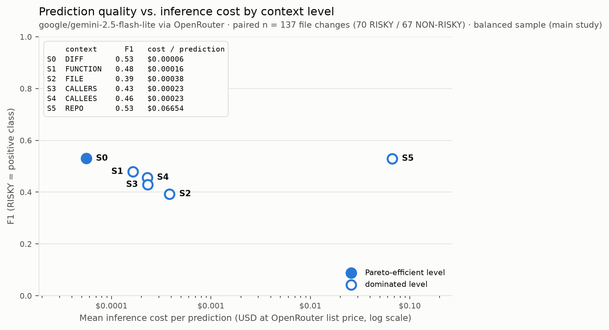

# Context level vs. LLM change-risk prediction — google/gemini-2.5-flash-lite (balanced sample, main study)

_Generated 2026-10-02T08:12:38+00:00 by `experiment.py report`. All numbers are computed from logged API responses._

## Setup

- **Data:** Defectors (Mahbub et al., MSR 2023), JIT split `time/test` (10,000 file changes: 1,246 RISKY / 8,754 NON-RISKY). Label = SZZ-derived defect-line annotation (paper's `induce_bug`, released as column `lines`): nonempty → RISKY, empty → NON-RISKY.
- **Sample:** 73 RISKY + 73 NON-RISKY single-file changes, seed 42, ≤1 file per commit; 1731 candidates examined in seeded order, 1585 excluded with logged reasons (modified `.py` file, non-merge commit, verified diff, parseable code, edits inside functions, BEFORE+AFTER ≤ 24,000 chars, diff ≤ 8,000 chars).
- **Model:** `google/gemini-2.5-flash-lite` via OpenRouter, provider pinned to `google-vertex` (no fallbacks), temperature 0, max_tokens 256, reasoning/thinking disabled; one stateless request per prediction, in seeded random order (876 predictions).
- **Context levels (identical instruction and settings; only the context differs):**
  - **S0 DIFF** — the target-file diff
  - **S1 FUNCTION** — S0 + complete enclosing functions, BEFORE and AFTER
  - **S2 FILE** — S0 + the complete target file, BEFORE and AFTER
  - **S3 CALLERS** — S1 + complete definitions of repository functions that call the changed functions
  - **S4 CALLEES** — S1 + complete definitions of repository functions that the changed functions call
  - **S5 REPO** — S2 + the repository's other Python files at the target commit, nearest to the target file first, whole files only, up to a fixed prompt budget (whole repository when it fits)
- **Context coverage:** callers found for 73/146 cases (median 0 per case; cap of 30 functions / 120,000 chars applied in 0 cases); callees found for 111/146 cases (median 2 per case; cap of 30 functions / 120,000 chars applied in 0 cases); the whole repository fit for 13/146 cases; otherwise a slice (median 11% of the repository's Python files included); S5 prompts averaged 665,558 input tokens, 63% of the model's 1,048,576-token window (budget fixed before the run at 2,500,000 prompt characters so that any tokenizer would fit). Callers/callees come from static `ast` analysis of the repository at the target commit (imports, `self`/`super()`/class calls, module aliases, plus repository-unique names); dynamic dispatch is not resolved.

## Results (paired set: n = 137 cases with a valid prediction at every level)

| Level | Precision | Recall | F1 | Accuracy | TP / FP / TN / FN | Mean input tokens | Mean output tokens | Mean latency (s) | Mean cost (list price) | Mean charged | Total charged |
|---|---|---|---|---|---|---|---|---|---|---|---|
| S0 DIFF | 0.66 | 0.44 | **0.53** | 0.60 | 31 / 16 / 51 / 39 | 362 | 48.7 | 0.67 | $0.00006 | $0.00006 | $0.0076 |
| S1 FUNCTION | 0.60 | 0.40 | **0.48** | 0.55 | 28 / 19 / 48 / 42 | 1,435 | 52.6 | 0.68 | $0.00016 | $0.00016 | $0.0225 |
| S2 FILE | 0.57 | 0.30 | **0.39** | 0.53 | 21 / 16 / 51 / 49 | 3,614 | 53.8 | 0.73 | $0.00038 | $0.00038 | $0.0525 |
| S3 CALLERS | 0.57 | 0.34 | **0.43** | 0.53 | 24 / 18 / 49 / 46 | 2,105 | 52.7 | 0.68 | $0.00023 | $0.00023 | $0.0317 |
| S4 CALLEES | 0.59 | 0.37 | **0.46** | 0.55 | 26 / 18 / 49 / 44 | 2,080 | 52.5 | 0.68 | $0.00023 | $0.00023 | $0.0314 |
| S5 REPO | 0.55 | 0.51 | **0.53** | 0.53 | 36 / 30 / 37 / 34 | 665,172 | 62.5 | 11.53 | $0.0665 | $0.0661 | $9.0577 |

### Trade-off against S0 DIFF

| Level | Cost per prediction | × cost of S0 | F1 [95% CI] | ΔF1 vs S0 [95% CI] | Correct | Fixed / broken vs S0 | Exact McNemar p | Extra cost per extra correct prediction | Pareto-efficient |
|---|---|---|---|---|---|---|---|---|---|
| S0 DIFF | $0.00006 | 1.0× | 0.53 [0.41, 0.63] | +0.00 | 82/137 | 0 / 0 | 1.00 | — | yes |
| S1 FUNCTION | $0.00016 | 3.0× | 0.48 [0.36, 0.59] | -0.05 [-0.14, +0.04] | 76/137 | 7 / 13 | 0.26 | — | no |
| S2 FILE | $0.00038 | 6.9× | 0.39 [0.27, 0.50] | -0.14 [-0.24, -0.04] | 72/137 | 7 / 17 | 0.06 | — | no |
| S3 CALLERS | $0.00023 | 4.2× | 0.43 [0.31, 0.54] | -0.10 [-0.20, -0.00] | 73/137 | 8 / 17 | 0.11 | — | no |
| S4 CALLEES | $0.00023 | 4.1× | 0.46 [0.34, 0.57] | -0.07 [-0.18, +0.03] | 75/137 | 9 / 16 | 0.23 | — | no |
| S5 REPO | $0.0665 | 1195.4× | 0.53 [0.42, 0.62] | -0.00 [-0.11, +0.11] | 73/137 | 17 / 26 | 0.22 | — | no |

_Trade-off costs use list price (input and output tokens × OpenRouter's per-token price), so that incidental provider-side caching cannot make a level look cheaper; actual charges are under spending._

**Sensitivity — all valid predictions per level** (not restricted to cases valid at every level): S0 F1 0.54 / accuracy 0.61 (n = 146); S1 F1 0.49 / accuracy 0.57 (n = 146); S2 F1 0.41 / accuracy 0.54 (n = 145); S3 F1 0.44 / accuracy 0.55 (n = 146); S4 F1 0.47 / accuracy 0.56 (n = 146); S5 F1 0.53 / accuracy 0.54 (n = 138).

**RQ1 — quality.** F1 by level: S0 0.53, S1 0.48, S2 0.39, S3 0.43, S4 0.46, S5 0.53. Highest: S0 (0.53). Correct predictions: S0 82/137, S1 76/137, S2 72/137, S3 73/137, S4 75/137, S5 73/137. Relative to S0, no level's case-level difference reaches p < 0.05 (exact McNemar); with n = 137 these differences are descriptive, not a statistically established ranking.

**RQ2 — trade-off.** Cost per prediction ranges from $0.00006 (S0) to $0.0665 (S5), a 1195× spread driven by input length. Pareto-efficient levels (no other level is at least as good and cheaper): S0. Dominated (another level is at least as good for less): S1, S2, S3, S4, S5. The best trade-off is the frontier point where the extra F1 is still worth its extra cost; given the sample size, F1 gaps of one or two cases should not drive that choice on their own.

## Examples where more context changed the outcome

_Correctness is judged only against the reference label; explanations are quoted model output, not evidence._

**case002 — context helped (S5 vs S0).** `commaai/openpilot` · `selfdrive/car/car_helpers.py` · commit `7bf70bf7d8` · reference **NON-RISKY**

- S0 DIFF: RISKY ✗ — “The `fingerprint` function now accepts an additional `num_pandas` argument, but this change is not propagated to the `get_car` function's signature, potentially leading to unexpected behavior or errors when `get_car` is called without this argument.”
- S1 FUNCTION: RISKY ✗ — “The `fingerprint` function now accepts a `num_pandas` argument, which is passed to `get_fw_versions_ordered`, potentially altering the firmware version retrieval logic and impacting car identification.”
- S2 FILE: NON-RISKY ✓ — “The `fingerprint` function now accepts an optional `num_pandas` argument, which is correctly passed to `get_fw_versions_ordered`, ensuring compatibility with multi-panda setups without altering existing functionality for single-panda systems.”
- S3 CALLERS: NON-RISKY ✓ — “The `fingerprint` function now accepts an optional `num_pandas` argument, which is correctly passed to `get_fw_versions_ordered`, improving multi-panda support without altering existing single-panda functionality.”
- S4 CALLEES: NON-RISKY ✓ — “The `fingerprint` function now accepts an optional `num_pandas` argument, which is correctly passed to `get_fw_versions_ordered`, ensuring compatibility with multi-panda setups without altering existing functionality for single-panda configurations.”
- S5 REPO: NON-RISKY ✓ — “The change introduces a new argument `num_pandas` to the `fingerprint` function and passes it to `get_fw_versions_ordered`, which is a non-functional change that does not alter the existing behavior or logic.”

**case038 — context helped (S5 vs S0).** `ray-project/ray` · `rllib/utils/pre_checks/multi_agent.py` · commit `9ece8acb0c` · reference **NON-RISKY**

- S0 DIFF: RISKY ✗ — “Changing a `ValueError` to a `logger.warning` for an undefined policy in `policies_to_train` might allow the program to proceed with potentially incorrect configurations, masking a functional issue.”
- S1 FUNCTION: RISKY ✗ — “The change replaces a `ValueError` with a `logger.warning` for undefined policies in `policies_to_train`, potentially masking configuration errors that could lead to unexpected behavior.”
- S2 FILE: NON-RISKY ✓ — “The change replaces a ValueError with a logger.warning for policies_to_train entries not found in policies, which is a less strict but potentially more user-friendly behavior.”
- S3 CALLERS: RISKY ✗ — “The change replaces a `ValueError` with a `logger.warning` for undefined policies in `policies_to_train`, potentially masking configuration errors that could lead to unexpected behavior.”
- S4 CALLEES: RISKY ✗ — “The change replaces a `ValueError` with a `logger.warning` for undefined policies in `policies_to_train`, potentially masking configuration errors that could lead to unexpected behavior.”
- S5 REPO: NON-RISKY ✓ — “The change replaces a `ValueError` with a `logger.warning` for a condition where `config.multiagent.policies_to_train` contains a policy ID not defined in `config.multiagent.policies`, which is a less strict error handling and unlikely to introduce functional defects.”

**case006 — context hurt (S5 vs S0).** `ray-project/ray` · `python/ray/workflow/workflow_state_from_dag.py` · commit `4a1ad3e87a` · reference **NON-RISKY**

- S0 DIFF: NON-RISKY ✓ — “The change removes a TODO comment and a redundant validation for `max_retries`, which is already handled by Ray's options system, and adds `retry_exceptions` to `WorkflowStepRuntimeOptions`.”
- S1 FUNCTION: NON-RISKY ✓ — “The change removes a redundant validation for 'max_retries' and adds a new 'retry_exceptions' parameter to WorkflowStepRuntimeOptions, which is a safe addition as it only introduces new functionality without altering existing logic.”
- S2 FILE: NON-RISKY ✓ — “The change removes a redundant validation for `max_retries` and adds `retry_exceptions` to `WorkflowStepRuntimeOptions`, which is a safe addition as it only introduces a new configurable option without altering existing logic.”
- S3 CALLERS: NON-RISKY ✓ — “The change removes redundant validation for `max_retries` and adds `retry_exceptions` to `WorkflowStepRuntimeOptions`, which are minor additions that do not alter core functionality or introduce new risks.”
- S4 CALLEES: NON-RISKY ✓ — “The change removes a redundant validation for `max_retries` and adds `retry_exceptions` to `WorkflowStepRuntimeOptions`, which are minor adjustments to existing functionality and do not introduce new behavior that could cause defects.”
- S5 REPO: RISKY ✗ — “The diff removes the validation check for `max_retries` which was previously ensuring that it was an integer and within the acceptable range of -1, 0, or positive integers.”

## Failures and spending

| Level | Valid | Invalid output | Failed | Not run | Attempts (all) | Charged, all attempts |
|---|---|---|---|---|---|---|
| S0 | 146 | 0 | 0 | 0 | 116 | $0.0064 |
| S1 | 146 | 0 | 0 | 0 | 116 | $0.0190 |
| S2 | 145 | 1 | 0 | 0 | 116 | $0.0450 |
| S3 | 146 | 0 | 0 | 0 | 116 | $0.0258 |
| S4 | 146 | 0 | 0 | 0 | 116 | $0.0265 |
| S5 | 138 | 8 | 0 | 0 | 116 | $7.7073 |

- **Actual charges for this model (OpenRouter `usage.cost`), all 697 logged attempts incl. 1 preflight check(s) and 0 retries: $7.8300.** Attempts with unknown cost: 0. Project total across all models: $10.0215.
- 180 predictions were reused from earlier runs of the identical request (same prompt, model and settings hash), originally charged $1.9871; they were not requested or charged again.
- Pre-run estimate (kept separate from charges): $12.0862; worst case $18.1664; project budget cap used by the paid run $12.00.
- Run 20261002T074005Z: key-level usage change $7.830019 vs. sum of per-request charges $7.830019 → reconciled at end of run.

## Caveats

- **Balanced sample** (73 RISKY / 73 NON-RISKY). The split's natural prevalence is about 12% RISKY, so precision in particular does not generalize.
- **Labels are automatically derived** (SZZ-based bug-inducing annotations with heuristic filtering) and can be noisy.
- **Restricted sample:** small files, function-internal edits, single modified files.
- **Both context content and input length change** between levels, so effects cannot be attributed to content alone.
- **No statistically established winner:** differences of a few cases on n = 137 are within sampling noise.
- **"Entire repository" is only literal where it fits:** most repositories (0.7M–15M tokens of Python) exceed any available context window, so S5 is a nearest-first slice under a budget fixed before the run (see context coverage for the share of files and of the window it used).
- **Callers/callees are static approximations:** framework callbacks and dynamically dispatched calls are missed; S3/S4 fall back to S1 content plus an explicit "none found" note in those cases.
- The repositories are public, so the model may have seen this code during training.

## Files

- `results/main/gemini-2.5-flash-lite/results.csv` — per-case, per-level predictions joined with labels
- `results/main/gemini-2.5-flash-lite/summary.csv` — metrics, tokens, latency, cost and trade-off columns per level
- `results/main/gemini-2.5-flash-lite/cost_vs_f1.png` — cost vs. F1 plot
- `results/main/gemini-2.5-flash-lite/attempts.jsonl`, `raw/`, `prompts/` — full request/response log
- `data/prepared/manifest.csv`, `selection_log.csv`, `context_summary.json` — frozen sample, exclusions, context coverage
