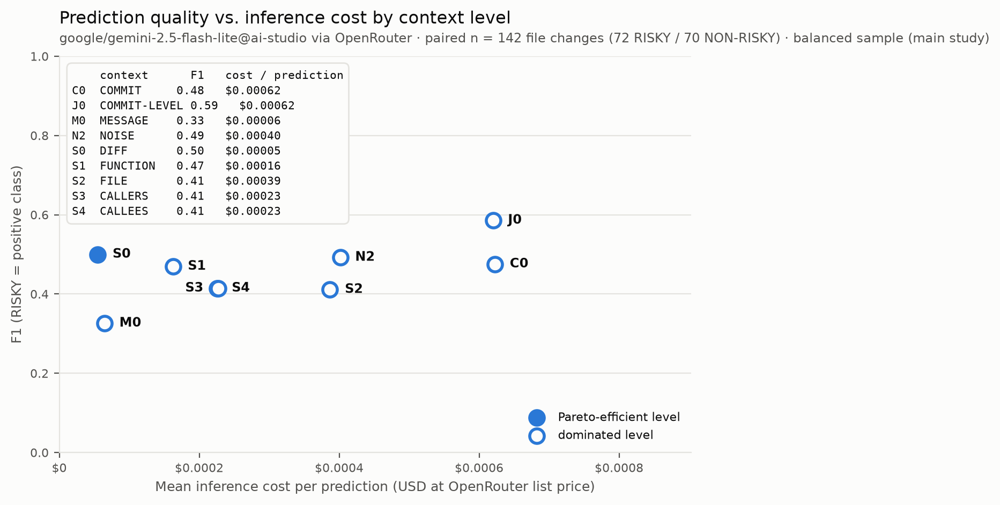

# Context level vs. LLM change-risk prediction — google/gemini-2.5-flash-lite@ai-studio (balanced sample, main study)

_Generated 2026-11-25T00:13:43+00:00 by `experiment.py report`. All numbers are computed from logged API responses._

## Setup

- **Data:** Defectors (Mahbub et al., MSR 2023), JIT split `time/test` (10,000 file changes: 1,246 RISKY / 8,754 NON-RISKY). Label = SZZ-derived defect-line annotation (paper's `induce_bug`, released as column `lines`): nonempty → RISKY, empty → NON-RISKY.
- **Sample:** 73 RISKY + 73 NON-RISKY single-file changes, seed 42, ≤1 file per commit; 1731 candidates examined in seeded order, 1585 excluded with logged reasons (modified `.py` file, non-merge commit, verified diff, parseable code, edits inside functions, BEFORE+AFTER ≤ 24,000 chars, diff ≤ 8,000 chars).
- **Model:** `google/gemini-2.5-flash-lite@ai-studio` via OpenRouter, provider pinned to `google-ai-studio` (no fallbacks), temperature 0, max_tokens 256, reasoning/thinking disabled; one stateless request per prediction, in seeded random order (1314 predictions).
- **Context levels (identical instruction and settings; only the context differs):**
  - **S0 DIFF** — the target-file diff
  - **S1 FUNCTION** — S0 + complete enclosing functions, BEFORE and AFTER
  - **S2 FILE** — S0 + the complete target file, BEFORE and AFTER
  - **S3 CALLERS** — S1 + complete definitions of repository functions that call the changed functions
  - **S4 CALLEES** — S1 + complete definitions of repository functions that the changed functions call
  - **N2 NOISE** — control: S0 + Python files from a different repository, cut to the number of characters S2 adds to S0 (same length as S2, no information about the change)
  - **M0 MESSAGE** — S0 + the target commit's message, verbatim
  - **C0 COMMIT** — S0 + the diffs of the other files changed by the target commit (same question about the target file)
  - **J0 COMMIT-LEVEL** — the whole commit diff, all files, with the question asked about the commit instead of the target file
- **Context coverage:** callers found for 73/146 cases (median 0 per case; cap of 30 functions / 120,000 chars applied in 0 cases); callees found for 111/146 cases (median 2 per case; cap of 30 functions / 120,000 chars applied in 0 cases). Callers/callees come from static `ast` analysis of the repository at the target commit (imports, `self`/`super()`/class calls, module aliases, plus repository-unique names); dynamic dispatch is not resolved.

## Results (paired set: n = 142 cases with a valid prediction at every level)

| Level | Precision | Recall | F1 | Accuracy | TP / FP / TN / FN | Mean input tokens | Mean output tokens | Mean latency (s) | Mean cost (list price) | Mean charged | Total charged |
|---|---|---|---|---|---|---|---|---|---|---|---|
| S0 DIFF | 0.70 | 0.39 | **0.50** | 0.61 | 28 / 12 / 58 / 44 | 362 | 46.8 | 0.48 | $0.00005 | $0.00005 | $0.0077 |
| S1 FUNCTION | 0.63 | 0.38 | **0.47** | 0.57 | 27 / 16 / 54 / 45 | 1,422 | 50.6 | 0.47 | $0.00016 | $0.00016 | $0.0223 |
| S2 FILE | 0.63 | 0.31 | **0.41** | 0.56 | 22 / 13 / 57 / 50 | 3,659 | 52.4 | 0.51 | $0.00039 | $0.00039 | $0.0549 |
| S3 CALLERS | 0.59 | 0.32 | **0.41** | 0.54 | 23 / 16 / 54 / 49 | 2,070 | 50.9 | 0.47 | $0.00023 | $0.00022 | $0.0319 |
| S4 CALLEES | 0.59 | 0.32 | **0.41** | 0.54 | 23 / 16 / 54 / 49 | 2,047 | 51.4 | 0.47 | $0.00023 | $0.00022 | $0.0315 |
| N2 NOISE | 0.55 | 0.44 | **0.49** | 0.54 | 32 / 26 / 44 / 40 | 3,805 | 52.5 | 0.50 | $0.00040 | $0.00040 | $0.0570 |
| M0 MESSAGE | 0.75 | 0.21 | **0.33** | 0.56 | 15 / 5 / 65 / 57 | 457 | 47.2 | 0.47 | $0.00006 | $0.00006 | $0.0092 |
| C0 COMMIT | 0.58 | 0.40 | **0.48** | 0.55 | 29 / 21 / 49 / 43 | 6,012 | 53.3 | 0.49 | $0.00062 | $0.00062 | $0.0884 |
| J0 COMMIT-LEVEL | 0.60 | 0.57 | **0.59** | 0.59 | 41 / 27 / 43 / 31 | 5,994 | 51.2 | 0.50 | $0.00062 | $0.00062 | $0.0880 |

### Trade-off against S0 DIFF

| Level | Cost per prediction | × cost of S0 | F1 [95% CI] | ΔF1 vs S0 [95% CI] | Correct | Fixed / broken vs S0 | Exact McNemar p | Extra cost per extra correct prediction | Pareto-efficient |
|---|---|---|---|---|---|---|---|---|---|
| S0 DIFF | $0.00005 | 1.0× | 0.50 [0.38, 0.61] | +0.00 | 86/142 | 0 / 0 | 1.00 | — | yes |
| S1 FUNCTION | $0.00016 | 3.0× | 0.47 [0.35, 0.58] | -0.03 [-0.10, +0.04] | 81/142 | 4 / 9 | 0.27 | — | no |
| S2 FILE | $0.00039 | 7.0× | 0.41 [0.28, 0.53] | -0.09 [-0.19, +0.01] | 79/142 | 7 / 14 | 0.19 | — | no |
| S3 CALLERS | $0.00023 | 4.1× | 0.41 [0.29, 0.52] | -0.09 [-0.18, +0.01] | 77/142 | 5 / 14 | 0.06 | — | no |
| S4 CALLEES | $0.00023 | 4.1× | 0.41 [0.29, 0.52] | -0.09 [-0.17, +0.00] | 77/142 | 3 / 12 | 0.04 | — | no |
| N2 NOISE | $0.00040 | 7.3× | 0.49 [0.38, 0.59] | -0.01 [-0.09, +0.08] | 76/142 | 9 / 19 | 0.09 | — | no |
| M0 MESSAGE | $0.00006 | 1.2× | 0.33 [0.20, 0.45] | -0.17 [-0.29, -0.07] | 80/142 | 10 / 16 | 0.33 | — | no |
| C0 COMMIT | $0.00062 | 11.3× | 0.48 [0.36, 0.58] | -0.02 [-0.13, +0.08] | 78/142 | 9 / 17 | 0.17 | — | no |
| J0 COMMIT-LEVEL | $0.00062 | 11.3× | 0.59 [0.48, 0.68] | +0.09 [-0.03, +0.20] | 84/142 | 21 / 23 | 0.88 | — | no |

_Trade-off costs use list price (input and output tokens × OpenRouter's per-token price), so that incidental provider-side caching cannot make a level look cheaper; actual charges are under spending._

**Sensitivity — all valid predictions per level** (not restricted to cases valid at every level): S0 F1 0.49 / accuracy 0.60 (n = 146); S1 F1 0.46 / accuracy 0.57 (n = 146); S2 F1 0.40 / accuracy 0.55 (n = 146); S3 F1 0.41 / accuracy 0.54 (n = 146); S4 F1 0.41 / accuracy 0.54 (n = 146); N2 F1 0.48 / accuracy 0.53 (n = 146); M0 F1 0.32 / accuracy 0.56 (n = 146); C0 F1 0.48 / accuracy 0.55 (n = 146); J0 F1 0.59 / accuracy 0.59 (n = 142).

**RQ1 — quality.** F1 by level: S0 0.50, S1 0.47, S2 0.41, S3 0.41, S4 0.41, N2 0.49, M0 0.33, C0 0.48, J0 0.59. Highest: J0 (0.59). Correct predictions: S0 86/142, S1 81/142, S2 79/142, S3 77/142, S4 77/142, N2 76/142, M0 80/142, C0 78/142, J0 84/142. Nominal p < 0.05 vs S0 for S4 (exploratory: n = 142, 8 comparisons, no correction); with n = 142 these differences are descriptive, not a statistically established ranking.

**RQ2 — trade-off.** Cost per prediction ranges from $0.00005 (S0) to $0.00062 (C0), a 11× spread driven by input length. Pareto-efficient levels (no other level is at least as good and cheaper): S0. Dominated (another level is at least as good for less): S1, S2, S3, S4, N2, M0, C0, J0. The best trade-off is the frontier point where the extra F1 is still worth its extra cost; given the sample size, F1 gaps of one or two cases should not drive that choice on their own.

## Examples where more context changed the outcome

_Correctness is judged only against the reference label; explanations are quoted model output, not evidence._

**case101 — context helped (S4 vs S0).** `apache/airflow` · `dev/breeze/src/airflow_breeze/utils/reinstall.py` · commit `9a6fc73aba` · reference **RISKY**

- S0 DIFF: NON-RISKY ✗ — “The change updates the command to include 'setup' which is a more accurate representation of the action being performed, without altering the core functionality.”
- S1 FUNCTION: RISKY ✓ — “The change modifies the command suggested to the user from 'self-upgrade' to 'setup self-upgrade', which alters the user-facing instructions and could lead to confusion or incorrect command execution if the underlying command structure has changed.”
- S2 FILE: RISKY ✓ — “The change modifies the command suggested to the user for reinstalling Breeze, potentially breaking the intended workflow if the new command is incorrect or less effective.”
- S3 CALLERS: RISKY ✓ — “The change modifies the command suggested to the user by adding the 'setup' subcommand, which could break existing workflows if the command structure has changed without corresponding backend updates.”
- S4 CALLEES: RISKY ✓ — “The change modifies the command string used in warning messages, potentially altering user-facing instructions and breaking existing workflows if the command syntax has changed in a non-backward-compatible way.”
- N2 NOISE: NON-RISKY ✗ — “The changes in `dev/breeze/src/airflow_breeze/utils/reinstall.py` are minor string updates to command-line instructions, which do not alter the core functionality or introduce new behavior that could cause defects.”
- M0 MESSAGE: NON-RISKY ✗ — “The change updates the command string to reflect a new subcommand 'setup' which is a documentation change and does not alter the functional behavior of the script.”
- C0 COMMIT: NON-RISKY ✗ — “The change updates the command syntax from 'self-upgrade' to 'setup self-upgrade', which is a minor refactoring and does not alter the core functionality or introduce new behavior that could cause defects.”
- J0 COMMIT-LEVEL: NON-RISKY ✗ — “The commit updates the command syntax from `self-upgrade` to `setup self-upgrade`, which is a minor change in command structure and likely intended for better organization without altering core functionality.”

**case105 — context helped (S4 vs S0).** `ray-project/ray` · `python/ray/data/_internal/shuffle_and_partition.py` · commit `081ce2fe4e` · reference **RISKY**

- S0 DIFF: NON-RISKY ✗ — “The change adds `copy=True` to the `slice` method, which is a default behavior and unlikely to alter existing functionality.”
- S1 FUNCTION: NON-RISKY ✗ — “The change adds `copy=True` to the `block.slice` call, which ensures that a copy of the data is made, preventing potential issues with shared mutable data between slices.”
- S2 FILE: NON-RISKY ✗ — “The change adds `copy=True` to the `block.slice` call, which ensures that slices are independent copies, preventing potential side effects and improving data integrity without altering the core functionality.”
- S3 CALLERS: RISKY ✓ — “Adding `copy=True` to the `block.slice` call might change the behavior if the original block was intended to be shared or modified in place, potentially leading to unexpected side effects or performance regressions.”
- S4 CALLEES: RISKY ✓ — “Adding `copy=True` to the `block.slice` call might change the behavior if the original block was intended to be shared, potentially leading to unexpected memory usage or performance implications.”
- N2 NOISE: NON-RISKY ✗ — “The change adds a `copy=True` argument to the `block.slice` method, which is a minor optimization that ensures a copy of the data is made, preventing potential side effects and not altering the core functionality.”
- M0 MESSAGE: NON-RISKY ✗ — “The change explicitly sets `copy=True` in the `block.slice` method, which is a safe default and unlikely to introduce functional defects.”
- C0 COMMIT: RISKY ✓ — “The change introduces `copy=True` to `block.slice` in `_ShufflePartitionOp`, which might lead to unnecessary data copying and performance degradation if the original slices were intended to be zero-copy views.”
- J0 COMMIT-LEVEL: RISKY ✓ — “The changes refactor Arrow serialization logic, moving from custom reducers to `ray.util.register_serializer`, which could introduce subtle behavioral differences or compatibility issues with older PyArrow versions.”

**case018 — context hurt (S4 vs S0).** `ray-project/ray` · `rllib/connectors/action/pipeline.py` · commit `5bf9d5084f` · reference **NON-RISKY**

- S0 DIFF: NON-RISKY ✓ — “The change simplifies the constructor by passing the connectors list to the superclass, which is a refactoring that does not alter the pipeline's core functionality.”
- S1 FUNCTION: RISKY ✗ — “The `is_training` method was removed, which could break functionality that relies on setting the training state for the pipeline's connectors.”
- S2 FILE: NON-RISKY ✓ — “The change refactors the `__init__` method to pass the `connectors` list to the parent class constructor, which is a valid refactoring that does not alter the pipeline's functionality.”
- S3 CALLERS: RISKY ✗ — “The `is_training` method was removed, which could break functionality that relies on setting the training state for pipeline connectors.”
- S4 CALLEES: RISKY ✗ — “The `is_training` method was removed, which could break functionality that relies on setting the training state for pipeline connectors.”
- N2 NOISE: NON-RISKY ✓ — “The change refactors the `__init__` method to pass the `connectors` list to the superclass constructor, which is a minor structural change that does not alter the core functionality.”
- M0 MESSAGE: NON-RISKY ✓ — “The change refactors the `__init__` method to pass the `connectors` list to the parent class, which is a structural change that does not alter the core functionality of the `ActionConnectorPipeline`.”
- C0 COMMIT: NON-RISKY ✓ — “The changes refactor the ConnectorPipeline initialization and mode setting, and update the AgentConnectorsOutput and ActionConnectorDataType to include the raw input dictionary, which is a structural change that does not alter the core functionality or introduce new behavior that could cause defects.”
- J0 COMMIT-LEVEL: NON-RISKY ✓ — “The changes refactor the data structures and logic for agent and action connectors, improving clarity and providing access to the raw input dictionary for action connectors without altering core functionality.”

## Reference: other models on the same frozen sample

_Each model's own paired set; not a head-to-head test._

| Model | Level | Paired n | F1 | Accuracy | Mean cost |
|---|---|---|---|---|---|
| claude-haiku-4.5 | S0 DIFF | 123 | 0.58 | 0.60 | $0.00075 |
| claude-haiku-4.5 | S1 FUNCTION | 123 | 0.50 | 0.55 | $0.00188 |
| claude-haiku-4.5 | S2 FILE | 123 | 0.52 | 0.53 | $0.00416 |
| claude-haiku-4.5 | S3 CALLERS | 123 | 0.53 | 0.56 | $0.00255 |
| claude-haiku-4.5 | S4 CALLEES | 123 | 0.52 | 0.56 | $0.00252 |
| claude-haiku-4.5 | N2 NOISE | 123 | 0.57 | 0.58 | $0.00430 |
| claude-haiku-4.5 | M0 MESSAGE | 123 | 0.50 | 0.59 | $0.00086 |
| claude-haiku-4.5 | C0 COMMIT | 123 | 0.49 | 0.56 | $0.00688 |
| claude-haiku-4.5 | J0 COMMIT-LEVEL | 123 | 0.59 | 0.54 | $0.00690 |
| claude-haiku-4.5_rep2 | S0 DIFF | 145 | 0.61 | 0.60 | $0.00075 |
| claude-haiku-4.5_rep2 | S2 FILE | 145 | 0.55 | 0.54 | $0.00427 |
| claude-sonnet-4.6 | S0 DIFF | 136 | 0.52 | 0.54 | $0.00221 |
| claude-sonnet-4.6 | S1 FUNCTION | 136 | 0.58 | 0.58 | $0.00560 |
| claude-sonnet-4.6 | S2 FILE | 136 | 0.60 | 0.61 | $0.0128 |
| claude-sonnet-4.6 | S3 CALLERS | 136 | 0.58 | 0.59 | $0.00770 |
| claude-sonnet-4.6 | S4 CALLEES | 136 | 0.57 | 0.58 | $0.00747 |
| claude-sonnet-4.6 | N2 NOISE | 136 | 0.60 | 0.60 | $0.0133 |
| claude-sonnet-4.6 | M0 MESSAGE | 136 | 0.56 | 0.60 | $0.00247 |
| claude-sonnet-4.6 | C0 COMMIT | 136 | 0.57 | 0.59 | $0.0201 |
| claude-sonnet-4.6 | J0 COMMIT-LEVEL | 136 | 0.66 | 0.60 | $0.0201 |
| claude-sonnet-4.6_rep2 | S0 DIFF | 144 | 0.54 | 0.57 | $0.00223 |
| claude-sonnet-4.6_rep2 | S2 FILE | 144 | 0.61 | 0.61 | $0.0128 |
| gemini-2.5-flash-lite | S0 DIFF | 137 | 0.53 | 0.60 | $0.00006 |
| gemini-2.5-flash-lite | S1 FUNCTION | 137 | 0.48 | 0.55 | $0.00016 |
| gemini-2.5-flash-lite | S2 FILE | 137 | 0.39 | 0.53 | $0.00038 |
| gemini-2.5-flash-lite | S3 CALLERS | 137 | 0.43 | 0.53 | $0.00023 |
| gemini-2.5-flash-lite | S4 CALLEES | 137 | 0.46 | 0.55 | $0.00023 |
| gemini-2.5-flash-lite | S5 REPO | 137 | 0.53 | 0.53 | $0.0665 |
| gemini-2.5-flash-lite_ai-studio_rep2 | S0 DIFF | 146 | 0.49 | 0.60 | $0.00006 |
| gemini-2.5-flash-lite_ai-studio_rep2 | S2 FILE | 146 | 0.40 | 0.55 | $0.00039 |
| qwen3.8-flash | S0 DIFF | 126 | 0.56 | 0.53 | $0.00008 |
| qwen3.8-flash | S1 FUNCTION | 126 | 0.59 | 0.59 | $0.00022 |
| qwen3.8-flash | S2 FILE | 126 | 0.56 | 0.55 | $0.00051 |
| qwen3.8-flash | S3 CALLERS | 126 | 0.57 | 0.57 | $0.00031 |
| qwen3.8-flash | S4 CALLEES | 126 | 0.60 | 0.60 | $0.00031 |
| qwen3.8-flash | N2 NOISE | 126 | 0.60 | 0.61 | $0.00053 |
| qwen3.8-flash | M0 MESSAGE | 126 | 0.58 | 0.58 | $0.00009 |
| qwen3.8-flash | C0 COMMIT | 126 | 0.52 | 0.54 | $0.00081 |
| qwen3.8-flash | J0 COMMIT-LEVEL | 126 | 0.66 | 0.58 | $0.00081 |
| qwen3.8-flash_rep2 | S0 DIFF | 143 | 0.59 | 0.54 | $0.00007 |
| qwen3.8-flash_rep2 | S2 FILE | 143 | 0.59 | 0.55 | $0.00051 |

## Failures and spending

| Level | Valid | Invalid output | Failed | Not run | Attempts (all) | Charged, all attempts |
|---|---|---|---|---|---|---|
| S0 | 146 | 0 | 0 | 0 | 150 | $0.0079 |
| S1 | 146 | 0 | 0 | 0 | 146 | $0.0231 |
| S2 | 146 | 0 | 0 | 0 | 147 | $0.0565 |
| S3 | 146 | 0 | 0 | 0 | 149 | $0.0329 |
| S4 | 146 | 0 | 0 | 0 | 147 | $0.0325 |
| N2 | 146 | 0 | 0 | 0 | 148 | $0.0587 |
| M0 | 146 | 0 | 0 | 0 | 151 | $0.0095 |
| C0 | 146 | 0 | 0 | 0 | 146 | $0.0914 |
| J0 | 142 | 4 | 0 | 0 | 148 | $0.0910 |

- **Actual charges for this model (OpenRouter `usage.cost`), all 1336 logged attempts incl. 4 preflight check(s) and 18 retries: $0.4034.** Attempts with unknown cost: 18. Project total across all models: $31.6556.
- 11 request(s) were billed partly at the provider's cache-read rate (case113/S1: 4,085 cached tokens, case134/S4: 1,020 cached tokens, case031/S4: 1,015 cached tokens, case072/S4: 2,041 cached tokens, case067/S4: 1,020 cached tokens, case021/S1: 1,012 cached tokens, case001/S1: 1,015 cached tokens, case081/S3: 3,064 cached tokens, case012/S3: 1,022 cached tokens, case012/S0: 1,012 cached tokens, case127/S1: 2,036 cached tokens), e.g. when a retry re-sent an identical prompt; charges include that discount, list-price costs do not.
- Pre-run estimate (kept separate from charges): $0.1973; worst case $0.3083; project budget cap used by the paid run $33.00.
- Run 20261119T000103Z: key-level usage change $0.000002 vs. sum of per-request charges $0.000002 → reconciled at end of run; halted: preflight failed: protocol_violation HTTP 200 served by provider 'Google AI Studio'.
- Run 20261119T002753Z: key-level usage change $0.211589 vs. sum of per-request charges $0.211589 → reconciled at end of run.
- Run 20261120T151513Z: key-level usage change $0.009473 vs. sum of per-request charges $0.009473 → reconciled at end of run.
- Run 20261124T233752Z: key-level usage change $0.182357 vs. sum of per-request charges $0.182358 → reconciled at end of run.

## Caveats

- **Balanced sample** (73 RISKY / 73 NON-RISKY). The split's natural prevalence is about 12% RISKY, so precision in particular does not generalize.
- **Labels are automatically derived** (SZZ-based bug-inducing annotations with heuristic filtering) and can be noisy.
- **Restricted sample:** small files, function-internal edits, single modified files.
- **Both context content and input length change** between levels, so effects cannot be attributed to content alone.
- **No statistically established winner:** differences of a few cases on n = 142 are within sampling noise.
- **Callers/callees are static approximations:** framework callbacks and dynamically dispatched calls are missed; S3/S4 fall back to S1 content plus an explicit "none found" note in those cases.
- The repositories are public, so the model may have seen this code during training.

## Files

- `results/main/gemini-2.5-flash-lite_ai-studio/results.csv` — per-case, per-level predictions joined with labels
- `results/main/gemini-2.5-flash-lite_ai-studio/summary.csv` — metrics, tokens, latency, cost and trade-off columns per level
- `results/main/gemini-2.5-flash-lite_ai-studio/cost_vs_f1.png` — cost vs. F1 plot
- `results/main/gemini-2.5-flash-lite_ai-studio/attempts.jsonl`, `raw/`, `prompts/` — full request/response log
- `data/prepared/manifest.csv`, `selection_log.csv`, `context_summary.json` — frozen sample, exclusions, context coverage
