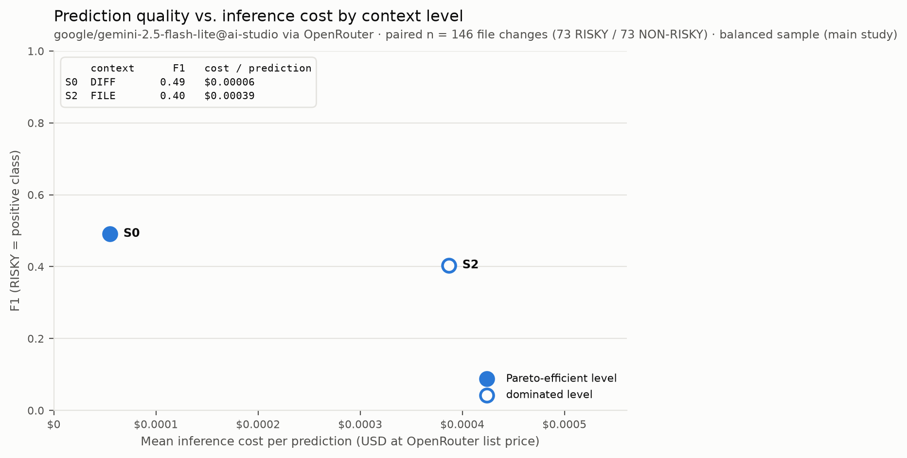

# Context level vs. LLM change-risk prediction — google/gemini-2.5-flash-lite@ai-studio (balanced sample, main study, identical re-run #2)

_Generated 2026-11-19T00:39:56+00:00 by `experiment.py report`. All numbers are computed from logged API responses._

## Setup

- **Data:** Defectors (Mahbub et al., MSR 2023), JIT split `time/test` (10,000 file changes: 1,246 RISKY / 8,754 NON-RISKY). Label = SZZ-derived defect-line annotation (paper's `induce_bug`, released as column `lines`): nonempty → RISKY, empty → NON-RISKY.
- **Sample:** 73 RISKY + 73 NON-RISKY single-file changes, seed 42, ≤1 file per commit; 1731 candidates examined in seeded order, 1585 excluded with logged reasons (modified `.py` file, non-merge commit, verified diff, parseable code, edits inside functions, BEFORE+AFTER ≤ 24,000 chars, diff ≤ 8,000 chars).
- **Model:** `google/gemini-2.5-flash-lite@ai-studio` via OpenRouter, provider pinned to `google-ai-studio` (no fallbacks), temperature 0, max_tokens 256, reasoning/thinking disabled; one stateless request per prediction, in seeded random order (292 predictions).
- **Context levels (identical instruction and settings; only the context differs):**
  - **S0 DIFF** — the target-file diff
  - **S2 FILE** — S0 + the complete target file, BEFORE and AFTER

## Results (paired set: n = 146 cases with a valid prediction at every level)

| Level | Precision | Recall | F1 | Accuracy | TP / FP / TN / FN | Mean input tokens | Mean output tokens | Mean latency (s) | Mean cost (list price) | Mean charged | Total charged |
|---|---|---|---|---|---|---|---|---|---|---|---|
| S0 DIFF | 0.68 | 0.38 | **0.49** | 0.60 | 28 / 13 / 60 / 45 | 362 | 47.0 | 0.47 | $0.00006 | $0.00005 | $0.0079 |
| S2 FILE | 0.61 | 0.30 | **0.40** | 0.55 | 22 / 14 / 59 / 51 | 3,658 | 52.6 | 0.49 | $0.00039 | $0.00029 | $0.0418 |

### Trade-off against S0 DIFF

| Level | Cost per prediction | × cost of S0 | F1 [95% CI] | ΔF1 vs S0 [95% CI] | Correct | Fixed / broken vs S0 | Exact McNemar p | Extra cost per extra correct prediction | Pareto-efficient |
|---|---|---|---|---|---|---|---|---|---|
| S0 DIFF | $0.00006 | 1.0× | 0.49 [0.38, 0.60] | +0.00 | 88/146 | 0 / 0 | 1.00 | — | yes |
| S2 FILE | $0.00039 | 7.0× | 0.40 [0.29, 0.51] | -0.09 [-0.19, +0.01] | 81/146 | 7 / 14 | 0.19 | — | no |

_Trade-off costs use list price (input and output tokens × OpenRouter's per-token price), so that incidental provider-side caching cannot make a level look cheaper; actual charges are under spending._

**Sensitivity — all valid predictions per level** (not restricted to cases valid at every level): S0 F1 0.49 / accuracy 0.60 (n = 146); S2 F1 0.40 / accuracy 0.55 (n = 146).

**RQ1 — quality.** F1 by level: S0 0.49, S2 0.40. Highest: S0 (0.49). Correct predictions: S0 88/146, S2 81/146. Relative to S0, no level's case-level difference reaches p < 0.05 (exact McNemar); with n = 146 these differences are descriptive, not a statistically established ranking.

**RQ2 — trade-off.** Cost per prediction ranges from $0.00006 (S0) to $0.00039 (S2), a 7× spread driven by input length. Pareto-efficient levels (no other level is at least as good and cheaper): S0. Dominated (another level is at least as good for less): S2. The best trade-off is the frontier point where the extra F1 is still worth its extra cost; given the sample size, F1 gaps of one or two cases should not drive that choice on their own.

## Examples where more context changed the outcome

_Correctness is judged only against the reference label; explanations are quoted model output, not evidence._

**case001 — context helped (S2 vs S0).** `getsentry/sentry` · `src/sentry/utils/metrics.py` · commit `0bb56c8219` · reference **NON-RISKY**

- S0 DIFF: RISKY ✗ — “The change renames a function and modifies its return type and implementation, potentially breaking existing code that calls the original function or relies on its previous behavior.”
- S2 FILE: NON-RISKY ✓ — “The change refactors the `global_tags` context manager into two functions, `_add_global_tags` and `add_global_tags`, improving code organization without altering the core functionality or behavior of tag management.”

**case054 — context helped (S2 vs S0).** `apache/airflow` · `scripts/ci/pre_commit/pre_commit_breeze_cmd_line.py` · commit `af2476f29d` · reference **NON-RISKY**

- S0 DIFF: RISKY ✗ — “The change replaces a direct function call to `regenerate_help_images_for_all_commands` with a call to `run_command` executing a shell command, which could lead to unexpected behavior if the shell command's output or error handling differs.”
- S2 FILE: NON-RISKY ✓ — “The change replaces a direct import and call to a specific function with a call to the 'breeze setup regenerate-command-images' command, which is functionally equivalent and likely more robust.”

**case016 — context hurt (S2 vs S0).** `Lightning-AI/lightning` · `src/pytorch_lightning/trainer/connectors/signal_connector.py` · commit `e5998e6bf2` · reference **RISKY**

- S0 DIFF: RISKY ✓ — “The change renames SIGUSR1 to a more generic sigusr and introduces logic to use a requeue_signal from the environment, which could lead to unexpected behavior if the environment's signal is not SIGUSR1 or if the handler is not compatible with the new signal.”
- S2 FILE: NON-RISKY ✗ — “The change generalizes the SIGUSR1 handler to be configurable via `environment.requeue_signal` for SLURM environments, improving flexibility without altering core functionality.”

## Reference: other models on the same frozen sample

_Each model's own paired set; not a head-to-head test._

| Model | Level | Paired n | F1 | Accuracy | Mean cost |
|---|---|---|---|---|---|
| claude-haiku-4.5 | S0 DIFF | 129 | 0.61 | 0.61 | $0.00075 |
| claude-haiku-4.5 | S1 FUNCTION | 129 | 0.53 | 0.56 | $0.00186 |
| claude-haiku-4.5 | S2 FILE | 129 | 0.55 | 0.54 | $0.00416 |
| claude-haiku-4.5 | S3 CALLERS | 129 | 0.56 | 0.57 | $0.00252 |
| claude-haiku-4.5 | S4 CALLEES | 129 | 0.55 | 0.57 | $0.00249 |
| claude-haiku-4.5 | N2 NOISE | 129 | 0.60 | 0.59 | $0.00430 |
| claude-haiku-4.5_rep2 | S0 DIFF | 145 | 0.61 | 0.60 | $0.00075 |
| claude-haiku-4.5_rep2 | S2 FILE | 145 | 0.55 | 0.54 | $0.00427 |
| gemini-2.5-flash-lite | S0 DIFF | 137 | 0.53 | 0.60 | $0.00006 |
| gemini-2.5-flash-lite | S1 FUNCTION | 137 | 0.48 | 0.55 | $0.00016 |
| gemini-2.5-flash-lite | S2 FILE | 137 | 0.39 | 0.53 | $0.00038 |
| gemini-2.5-flash-lite | S3 CALLERS | 137 | 0.43 | 0.53 | $0.00023 |
| gemini-2.5-flash-lite | S4 CALLEES | 137 | 0.46 | 0.55 | $0.00023 |
| gemini-2.5-flash-lite | S5 REPO | 137 | 0.53 | 0.53 | $0.0665 |
| gemini-2.5-flash-lite_ai-studio | S0 DIFF | 146 | 0.49 | 0.60 | $0.00006 |
| gemini-2.5-flash-lite_ai-studio | S1 FUNCTION | 146 | 0.46 | 0.57 | $0.00016 |
| gemini-2.5-flash-lite_ai-studio | S2 FILE | 146 | 0.40 | 0.55 | $0.00039 |
| gemini-2.5-flash-lite_ai-studio | S3 CALLERS | 146 | 0.41 | 0.54 | $0.00023 |
| gemini-2.5-flash-lite_ai-studio | S4 CALLEES | 146 | 0.41 | 0.54 | $0.00023 |
| gemini-2.5-flash-lite_ai-studio | N2 NOISE | 146 | 0.48 | 0.53 | $0.00040 |

## Failures and spending

| Level | Valid | Invalid output | Failed | Not run | Attempts (all) | Charged, all attempts |
|---|---|---|---|---|---|---|
| S0 | 146 | 0 | 0 | 0 | 147 | $0.0079 |
| S2 | 146 | 0 | 0 | 0 | 148 | $0.0418 |

- **Actual charges for this model (OpenRouter `usage.cost`), all 297 logged attempts incl. 2 preflight check(s) and 3 retries: $0.0497.** Attempts with unknown cost: 3. Project total across all models: $13.2174.
- 45 request(s) were billed partly at the provider's cache-read rate (case080/S2: 2,036 cached tokens, case043/S2: 2,036 cached tokens, case048/S2: 2,038 cached tokens, case076/S2: 3,061 cached tokens, case110/S2: 4,085 cached tokens, case105/S2: 2,037 cached tokens, case001/S2: 4,086 cached tokens, case003/S2: 3,061 cached tokens, case019/S2: 4,085 cached tokens, case037/S2: 2,039 cached tokens, case121/S2: 2,039 cached tokens, case067/S2: 3,061 cached tokens, case097/S2: 6,132 cached tokens, case138/S2: 5,108 cached tokens, case028/S2: 4,084 cached tokens, case136/S2: 6,132 cached tokens, case005/S2: 3,061 cached tokens, case061/S2: 2,036 cached tokens, case125/S2: 2,038 cached tokens, case113/S0: 1,013 cached tokens, case017/S2: 3,060 cached tokens, case124/S2: 4,084 cached tokens, case077/S2: 6,132 cached tokens, case095/S2: 3,060 cached tokens, case054/S2: 3,060 cached tokens, case004/S2: 5,108 cached tokens, case106/S2: 2,037 cached tokens, case014/S2: 3,061 cached tokens, case065/S2: 7,156 cached tokens, case104/S2: 2,037 cached tokens, case015/S2: 4,085 cached tokens, case123/S2: 1,013 cached tokens, case100/S2: 6,133 cached tokens, case012/S2: 9,204 cached tokens, case087/S2: 3,060 cached tokens, case072/S2: 6,133 cached tokens, case027/S2: 3,060 cached tokens, case111/S2: 4,085 cached tokens, case099/S2: 4,086 cached tokens, case127/S2: 2,039 cached tokens, case038/S2: 3,060 cached tokens, case016/S2: 4,084 cached tokens, case068/S2: 3,062 cached tokens, case092/S2: 4,084 cached tokens, case143/S2: 5,108 cached tokens), e.g. when a retry re-sent an identical prompt; charges include that discount, list-price costs do not.
- Pre-run estimate (kept separate from charges): $0.0832; worst case $0.1372; project budget cap used by the paid run $16.00.
- Run 20261119T001958Z: key-level usage change $0.000002 vs. sum of per-request charges $0.000002 → reconciled at end of run; halted: preflight failed: protocol_violation HTTP 200 served by provider 'Google AI Studio'.
- Run 20261119T003650Z: key-level usage change $0.049717 vs. sum of per-request charges $0.049717 → reconciled at end of run.

## Caveats

- **Balanced sample** (73 RISKY / 73 NON-RISKY). The split's natural prevalence is about 12% RISKY, so precision in particular does not generalize.
- **Labels are automatically derived** (SZZ-based bug-inducing annotations with heuristic filtering) and can be noisy.
- **Restricted sample:** small files, function-internal edits, single modified files.
- **Both context content and input length change** between levels, so effects cannot be attributed to content alone.
- **No statistically established winner:** differences of a few cases on n = 146 are within sampling noise.
- The repositories are public, so the model may have seen this code during training.

## Files

- `results/main/gemini-2.5-flash-lite_ai-studio_rep2/results.csv` — per-case, per-level predictions joined with labels
- `results/main/gemini-2.5-flash-lite_ai-studio_rep2/summary.csv` — metrics, tokens, latency, cost and trade-off columns per level
- `results/main/gemini-2.5-flash-lite_ai-studio_rep2/cost_vs_f1.png` — cost vs. F1 plot
- `results/main/gemini-2.5-flash-lite_ai-studio_rep2/attempts.jsonl`, `raw/`, `prompts/` — full request/response log
- `data/prepared/manifest.csv`, `selection_log.csv`, `context_summary.json` — frozen sample, exclusions, context coverage
