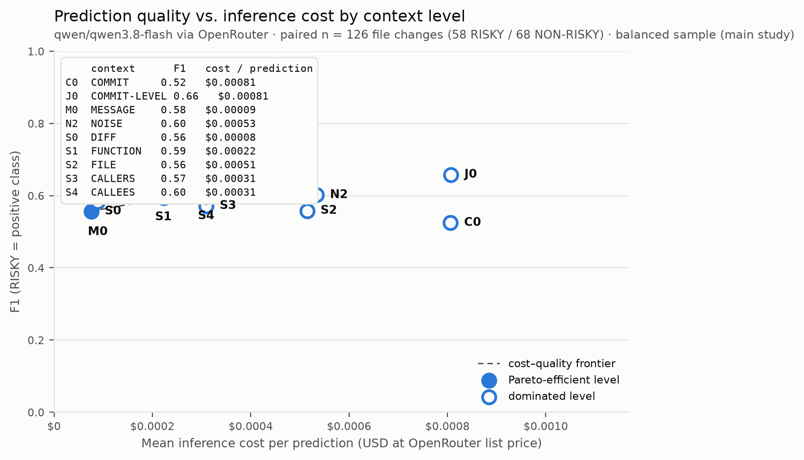

# Context level vs. LLM change-risk prediction — qwen/qwen3.8-flash (balanced sample, main study)

_Generated 2026-11-25T00:13:44+00:00 by `experiment.py report`. All numbers are computed from logged API responses._

## Setup

- **Data:** Defectors (Mahbub et al., MSR 2023), JIT split `time/test` (10,000 file changes: 1,246 RISKY / 8,754 NON-RISKY). Label = SZZ-derived defect-line annotation (paper's `induce_bug`, released as column `lines`): nonempty → RISKY, empty → NON-RISKY.
- **Sample:** 73 RISKY + 73 NON-RISKY single-file changes, seed 42, ≤1 file per commit; 1731 candidates examined in seeded order, 1585 excluded with logged reasons (modified `.py` file, non-merge commit, verified diff, parseable code, edits inside functions, BEFORE+AFTER ≤ 24,000 chars, diff ≤ 8,000 chars).
- **Model:** `qwen/qwen3.8-flash` via OpenRouter, provider pinned to `alibaba` (no fallbacks), temperature 0, max_tokens 256, reasoning/thinking disabled; one stateless request per prediction, in seeded random order (1314 predictions).
- **Context levels (identical instruction and settings; only the context differs):**
  - **S0 DIFF** — the target-file diff
  - **S1 FUNCTION** — S0 + complete enclosing functions, BEFORE and AFTER
  - **S2 FILE** — S0 + the complete target file, BEFORE and AFTER
  - **S3 CALLERS** — S1 + complete definitions of repository functions that call the changed functions
  - **S4 CALLEES** — S1 + complete definitions of repository functions that the changed functions call
  - **N2 NOISE** — control: S0 + Python files from a different repository, cut to the number of characters S2 adds to S0 (same length as S2, no information about the change)
  - **M0 MESSAGE** — S0 + the target commit's message, verbatim
  - **C0 COMMIT** — S0 + the diffs of the other files changed by the target commit (same question about the target file)
  - **J0 COMMIT-LEVEL** — the whole commit diff, all files, with the question asked about the commit instead of the target file
- **Context coverage:** callers found for 73/146 cases (median 0 per case; cap of 30 functions / 120,000 chars applied in 0 cases); callees found for 111/146 cases (median 2 per case; cap of 30 functions / 120,000 chars applied in 0 cases). Callers/callees come from static `ast` analysis of the repository at the target commit (imports, `self`/`super()`/class calls, module aliases, plus repository-unique names); dynamic dispatch is not resolved.

## Results (paired set: n = 126 cases with a valid prediction at every level)

| Level | Precision | Recall | F1 | Accuracy | TP / FP / TN / FN | Mean input tokens | Mean output tokens | Mean latency (s) | Mean cost (list price) | Mean charged | Total charged |
|---|---|---|---|---|---|---|---|---|---|---|---|
| S0 DIFF | 0.49 | 0.64 | **0.56** | 0.53 | 37 / 38 / 30 / 21 | 351 | 49.2 | 1.76 | $0.00008 | $0.00007 | $0.0094 |
| S1 FUNCTION | 0.54 | 0.66 | **0.59** | 0.59 | 38 / 32 / 36 / 20 | 1,319 | 52.6 | 1.69 | $0.00022 | $0.00020 | $0.0249 |
| S2 FILE | 0.51 | 0.62 | **0.56** | 0.55 | 36 / 35 / 33 / 22 | 3,263 | 53.2 | 1.98 | $0.00051 | $0.00051 | $0.0647 |
| S3 CALLERS | 0.53 | 0.62 | **0.57** | 0.57 | 36 / 32 / 36 / 22 | 1,889 | 55.4 | 1.76 | $0.00031 | $0.00027 | $0.0344 |
| S4 CALLEES | 0.56 | 0.64 | **0.60** | 0.60 | 37 / 29 / 39 / 21 | 1,895 | 53.6 | 1.70 | $0.00031 | $0.00027 | $0.0344 |
| N2 NOISE | 0.57 | 0.64 | **0.60** | 0.61 | 37 / 28 / 40 / 21 | 3,396 | 51.5 | 1.96 | $0.00053 | $0.00053 | $0.0671 |
| M0 MESSAGE | 0.54 | 0.64 | **0.58** | 0.58 | 37 / 32 / 36 / 21 | 441 | 48.9 | 1.60 | $0.00009 | $0.00009 | $0.0111 |
| C0 COMMIT | 0.50 | 0.55 | **0.52** | 0.54 | 32 / 32 / 36 / 26 | 5,197 | 56.9 | 1.76 | $0.00081 | $0.00081 | $0.1016 |
| J0 COMMIT-LEVEL | 0.53 | 0.88 | **0.66** | 0.58 | 51 / 46 / 22 / 7 | 5,187 | 61.3 | 1.82 | $0.00081 | $0.00081 | $0.1017 |

### Trade-off against S0 DIFF

| Level | Cost per prediction | × cost of S0 | F1 [95% CI] | ΔF1 vs S0 [95% CI] | Correct | Fixed / broken vs S0 | Exact McNemar p | Extra cost per extra correct prediction | Pareto-efficient |
|---|---|---|---|---|---|---|---|---|---|
| S0 DIFF | $0.00008 | 1.0× | 0.56 [0.45, 0.65] | +0.00 | 67/126 | 0 / 0 | 1.00 | — | yes |
| S1 FUNCTION | $0.00022 | 2.9× | 0.59 [0.49, 0.69] | +0.04 [-0.03, +0.10] | 74/126 | 12 / 5 | 0.14 | $0.00264 | yes |
| S2 FILE | $0.00051 | 6.8× | 0.56 [0.45, 0.66] | +0.00 [-0.07, +0.07] | 69/126 | 10 / 8 | 0.81 | $0.0276 | no |
| S3 CALLERS | $0.00031 | 4.1× | 0.57 [0.46, 0.67] | +0.02 [-0.04, +0.07] | 72/126 | 10 / 5 | 0.30 | $0.00589 | no |
| S4 CALLEES | $0.00031 | 4.1× | 0.60 [0.49, 0.70] | +0.04 [-0.02, +0.10] | 76/126 | 15 / 6 | 0.08 | $0.00327 | yes |
| N2 NOISE | $0.00053 | 7.0× | 0.60 [0.49, 0.70] | +0.05 [-0.02, +0.11] | 77/126 | 15 / 5 | 0.04 | $0.00577 | no |
| M0 MESSAGE | $0.00009 | 1.2× | 0.58 [0.47, 0.68] | +0.03 [-0.04, +0.09] | 73/126 | 12 / 6 | 0.24 | $0.00028 | no |
| C0 COMMIT | $0.00081 | 10.6× | 0.52 [0.41, 0.62] | -0.03 [-0.11, +0.04] | 68/126 | 11 / 10 | 1.00 | $0.0921 | no |
| J0 COMMIT-LEVEL | $0.00081 | 10.7× | 0.66 [0.57, 0.74] | +0.10 [+0.01, +0.20] | 73/126 | 20 / 14 | 0.39 | $0.0154 | no |

_Trade-off costs use list price (input and output tokens × OpenRouter's per-token price), so that incidental provider-side caching cannot make a level look cheaper; actual charges are under spending._

**Sensitivity — all valid predictions per level** (not restricted to cases valid at every level): S0 F1 0.58 / accuracy 0.54 (n = 140); S1 F1 0.62 / accuracy 0.59 (n = 145); S2 F1 0.59 / accuracy 0.56 (n = 144); S3 F1 0.60 / accuracy 0.58 (n = 144); S4 F1 0.61 / accuracy 0.59 (n = 144); N2 F1 0.60 / accuracy 0.59 (n = 143); M0 F1 0.61 / accuracy 0.59 (n = 143); C0 F1 0.55 / accuracy 0.55 (n = 142); J0 F1 0.69 / accuracy 0.60 (n = 144).

**RQ1 — quality.** F1 by level: S0 0.56, S1 0.59, S2 0.56, S3 0.57, S4 0.60, N2 0.60, M0 0.58, C0 0.52, J0 0.66. Highest: J0 (0.66). Correct predictions: S0 67/126, S1 74/126, S2 69/126, S3 72/126, S4 76/126, N2 77/126, M0 73/126, C0 68/126, J0 73/126. Nominal p < 0.05 vs S0 for N2 (exploratory: n = 126, 8 comparisons, no correction); with n = 126 these differences are descriptive, not a statistically established ranking.

**RQ2 — trade-off.** Cost per prediction ranges from $0.00008 (S0) to $0.00081 (J0), a 11× spread driven by input length. Pareto-efficient levels (no other level is at least as good and cheaper): S0, S1, S4; along that frontier S0 → S1: F1 0.56 → 0.59 for 2.9× the cost; S1 → S4: F1 0.59 → 0.60 for 1.4× the cost. Dominated (another level is at least as good for less): S2, S3, N2, M0, C0, J0. The best trade-off is the frontier point where the extra F1 is still worth its extra cost; given the sample size, F1 gaps of one or two cases should not drive that choice on their own.

## Examples where more context changed the outcome

_Correctness is judged only against the reference label; explanations are quoted model output, not evidence._

**case008 — context helped (S4 vs S0).** `Lightning-AI/lightning` · `src/lightning_lite/strategies/parallel.py` · commit `d15bd1520e` · reference **NON-RISKY**

- S0 DIFF: RISKY ✗ — “The change renames the parameter `precision_plugin` to `precision`, which will break existing callers passing the argument by keyword and may cause errors if the parent class signature has not been updated accordingly.”
- S1 FUNCTION: RISKY ✗ — “Renaming the parameter from `precision_plugin` to `precision` breaks backward compatibility for any existing code that instantiates `ParallelStrategy` using the old keyword argument name.”
- S2 FILE: RISKY ✗ — “The change renames the `precision_plugin` parameter to `precision` in both the constructor signature and the call to `super().__init__`, which will break any existing code that instantiates `ParallelStrategy` subclasses or calls this constructor using the old keyword argument name.”
- S3 CALLERS: NON-RISKY ✓ — “The change consistently renames the parameter from 'precision_plugin' to 'precision' in both the method signature and the super() call, and all identified callers already use the new 'precision' keyword argument.”
- S4 CALLEES: NON-RISKY ✓ — “The change correctly renames the parameter and keyword argument to match the updated signature of the parent class Strategy.__init__, ensuring proper initialization without introducing defects.”
- N2 NOISE: NON-RISKY ✓ — “The change renames the parameter from precision_plugin to precision in both the signature and the super().__init__ call, which is a consistent API update that does not introduce functional defects.”
- M0 MESSAGE: RISKY ✗ — “The change renames the parameter from precision_plugin to precision in both the signature and the super().__init__ call, which will break any existing code or subclasses that pass or expect the old keyword argument name.”
- C0 COMMIT: NON-RISKY ✓ — “The change is a consistent refactoring renaming 'precision_plugin' to 'precision' across the codebase, with all references updated in the target file and dependent files.”
- J0 COMMIT-LEVEL: NON-RISKY ✓ — “The commit performs a consistent refactoring of internal attribute names (e.g., changing `precision_plugin` to `precision`) across the codebase and tests, without altering functional logic or introducing new behavior defects.”

**case017 — context helped (S4 vs S0).** `apache/airflow` · `airflow/providers/snowflake/transfers/s3_to_snowflake.py` · commit `8a34d25049` · reference **NON-RISKY**

- S0 DIFF: RISKY ✗ — “The change replaces manual string quoting with a helper function `enclose_param` that is not imported or defined in the visible scope, which will likely cause a NameError at runtime.”
- S1 FUNCTION: NON-RISKY ✓ — “The change replaces manual string quoting with the existing `enclose_param` utility, which is already used for similar parameters in the same function and provides safer SQL injection protection without altering functional behavior.”
- S2 FILE: NON-RISKY ✓ — “The change replaces manual string formatting with the existing `enclose_param` utility function, which correctly handles SQL quoting and escaping for S3 keys, improving security and consistency without introducing functional defects.”
- S3 CALLERS: NON-RISKY ✓ — “The change replaces manual string quoting with the existing `enclose_param` utility, which is already used for `pattern` in the same function, ensuring consistent and safe parameter handling without introducing new defects.”
- S4 CALLEES: NON-RISKY ✓ — “The change replaces manual string quoting with the existing `enclose_param` utility, which correctly handles single quotes in S3 keys, thereby fixing a potential SQL injection or syntax error bug without introducing new defects.”
- N2 NOISE: RISKY ✗ — “The change replaces manual string formatting with `enclose_param`, which may alter the quoting or escaping behavior of S3 keys in the SQL query, potentially leading to syntax errors or injection vulnerabilities if `enclose_param` does not handle all edge cases identically to the previous implementation.”
- M0 MESSAGE: NON-RISKY ✓ — “The change replaces manual string formatting with a dedicated escaping function to prevent SQL injection, which is a security fix rather than a functional defect.”
- C0 COMMIT: RISKY ✗ — “The change introduces a dependency on `enclose_param` which is not imported in the provided diff context, likely causing a NameError at runtime.”
- J0 COMMIT-LEVEL: RISKY ✗ — “The commit introduces a dependency on `enclose_param` which is not imported in the modified file, likely causing a NameError at runtime.”

**case002 — context hurt (S4 vs S0).** `commaai/openpilot` · `selfdrive/car/car_helpers.py` · commit `7bf70bf7d8` · reference **NON-RISKY**

- S0 DIFF: NON-RISKY ✓ — “The change adds a new parameter with a default value to maintain backward compatibility and passes it through to the underlying function, which is a standard refactoring pattern unlikely to introduce defects.”
- S1 FUNCTION: RISKY ✗ — “The `fingerprint` function signature was changed to require a new positional argument `num_pandas`, but existing callers that invoke `fingerprint(logcan, sendcan)` without this argument will raise a TypeError.”
- S2 FILE: RISKY ✗ — “The `fingerprint` function signature was changed to require a new mandatory argument `num_pandas`, which will cause a TypeError if any existing callers of this function are not updated to pass this argument.”
- S3 CALLERS: RISKY ✗ — “The caller `get_car_params` in `process_replay.py` invokes `get_car` with only two arguments, but the updated signature requires a third argument (`num_pandas`) or relies on a default that might not be intended for all contexts, potentially causing a TypeError if the default isn't sufficient or if strict positional matching is expected in other unlisted callers.”
- S4 CALLEES: RISKY ✗ — “The `fingerprint` function signature was changed to require a new positional argument `num_pandas`, but the diff does not show updates to all call sites, which will cause runtime TypeErrors if any caller invokes it without this argument.”
- N2 NOISE: RISKY ✗ — “The change adds a required positional argument `num_pandas` to the `fingerprint` function, which will cause runtime errors if any existing callers do not provide this new argument.”
- M0 MESSAGE: RISKY ✗ — “The change introduces a new required argument `num_pandas` to the internal `fingerprint` function, which will cause a TypeError if any other code path calls `fingerprint` directly without updating its arguments, although `get_car` is updated.”
- C0 COMMIT: RISKY ✗ — “The change introduces a dependency on `num_pandas` to filter CAN bus queries, but if `pandaStates` is not yet available or returns an empty list during initialization in `controlsd.py`, `num_pandas` defaults to 0 (or causes errors), potentially skipping necessary fingerprinting steps for multi-panda setups.”
- J0 COMMIT-LEVEL: RISKY ✗ — “The commit introduces a dependency on `pandaStates` for determining the number of pandas in `controlsd.py`, but moves the initialization of `self.sm` before the check for `CI is None`, potentially causing issues if `sm` is passed as an argument or if `pandaStates` is not available when expected, and the logic change in `get_fw_versions` to skip queries based on bus index might incorrectly filter valid ECUs if `num_pandas` is misinterpreted or defaults are inconsistent.”

## Reference: other models on the same frozen sample

_Each model's own paired set; not a head-to-head test._

| Model | Level | Paired n | F1 | Accuracy | Mean cost |
|---|---|---|---|---|---|
| claude-haiku-4.5 | S0 DIFF | 123 | 0.58 | 0.60 | $0.00075 |
| claude-haiku-4.5 | S1 FUNCTION | 123 | 0.50 | 0.55 | $0.00188 |
| claude-haiku-4.5 | S2 FILE | 123 | 0.52 | 0.53 | $0.00416 |
| claude-haiku-4.5 | S3 CALLERS | 123 | 0.53 | 0.56 | $0.00255 |
| claude-haiku-4.5 | S4 CALLEES | 123 | 0.52 | 0.56 | $0.00252 |
| claude-haiku-4.5 | N2 NOISE | 123 | 0.57 | 0.58 | $0.00430 |
| claude-haiku-4.5 | M0 MESSAGE | 123 | 0.50 | 0.59 | $0.00086 |
| claude-haiku-4.5 | C0 COMMIT | 123 | 0.49 | 0.56 | $0.00688 |
| claude-haiku-4.5 | J0 COMMIT-LEVEL | 123 | 0.59 | 0.54 | $0.00690 |
| claude-haiku-4.5_rep2 | S0 DIFF | 145 | 0.61 | 0.60 | $0.00075 |
| claude-haiku-4.5_rep2 | S2 FILE | 145 | 0.55 | 0.54 | $0.00427 |
| claude-sonnet-4.6 | S0 DIFF | 136 | 0.52 | 0.54 | $0.00221 |
| claude-sonnet-4.6 | S1 FUNCTION | 136 | 0.58 | 0.58 | $0.00560 |
| claude-sonnet-4.6 | S2 FILE | 136 | 0.60 | 0.61 | $0.0128 |
| claude-sonnet-4.6 | S3 CALLERS | 136 | 0.58 | 0.59 | $0.00770 |
| claude-sonnet-4.6 | S4 CALLEES | 136 | 0.57 | 0.58 | $0.00747 |
| claude-sonnet-4.6 | N2 NOISE | 136 | 0.60 | 0.60 | $0.0133 |
| claude-sonnet-4.6 | M0 MESSAGE | 136 | 0.56 | 0.60 | $0.00247 |
| claude-sonnet-4.6 | C0 COMMIT | 136 | 0.57 | 0.59 | $0.0201 |
| claude-sonnet-4.6 | J0 COMMIT-LEVEL | 136 | 0.66 | 0.60 | $0.0201 |
| claude-sonnet-4.6_rep2 | S0 DIFF | 144 | 0.54 | 0.57 | $0.00223 |
| claude-sonnet-4.6_rep2 | S2 FILE | 144 | 0.61 | 0.61 | $0.0128 |
| gemini-2.5-flash-lite | S0 DIFF | 137 | 0.53 | 0.60 | $0.00006 |
| gemini-2.5-flash-lite | S1 FUNCTION | 137 | 0.48 | 0.55 | $0.00016 |
| gemini-2.5-flash-lite | S2 FILE | 137 | 0.39 | 0.53 | $0.00038 |
| gemini-2.5-flash-lite | S3 CALLERS | 137 | 0.43 | 0.53 | $0.00023 |
| gemini-2.5-flash-lite | S4 CALLEES | 137 | 0.46 | 0.55 | $0.00023 |
| gemini-2.5-flash-lite | S5 REPO | 137 | 0.53 | 0.53 | $0.0665 |
| gemini-2.5-flash-lite_ai-studio | S0 DIFF | 142 | 0.50 | 0.61 | $0.00005 |
| gemini-2.5-flash-lite_ai-studio | S1 FUNCTION | 142 | 0.47 | 0.57 | $0.00016 |
| gemini-2.5-flash-lite_ai-studio | S2 FILE | 142 | 0.41 | 0.56 | $0.00039 |
| gemini-2.5-flash-lite_ai-studio | S3 CALLERS | 142 | 0.41 | 0.54 | $0.00023 |
| gemini-2.5-flash-lite_ai-studio | S4 CALLEES | 142 | 0.41 | 0.54 | $0.00023 |
| gemini-2.5-flash-lite_ai-studio | N2 NOISE | 142 | 0.49 | 0.54 | $0.00040 |
| gemini-2.5-flash-lite_ai-studio | M0 MESSAGE | 142 | 0.33 | 0.56 | $0.00006 |
| gemini-2.5-flash-lite_ai-studio | C0 COMMIT | 142 | 0.48 | 0.55 | $0.00062 |
| gemini-2.5-flash-lite_ai-studio | J0 COMMIT-LEVEL | 142 | 0.59 | 0.59 | $0.00062 |
| gemini-2.5-flash-lite_ai-studio_rep2 | S0 DIFF | 146 | 0.49 | 0.60 | $0.00006 |
| gemini-2.5-flash-lite_ai-studio_rep2 | S2 FILE | 146 | 0.40 | 0.55 | $0.00039 |
| qwen3.8-flash_rep2 | S0 DIFF | 143 | 0.59 | 0.54 | $0.00007 |
| qwen3.8-flash_rep2 | S2 FILE | 143 | 0.59 | 0.55 | $0.00051 |

## Failures and spending

| Level | Valid | Invalid output | Failed | Not run | Attempts (all) | Charged, all attempts |
|---|---|---|---|---|---|---|
| S0 | 140 | 6 | 0 | 0 | 148 | $0.0108 |
| S1 | 145 | 1 | 0 | 0 | 149 | $0.0280 |
| S2 | 144 | 2 | 0 | 0 | 146 | $0.0742 |
| S3 | 144 | 2 | 0 | 0 | 146 | $0.0391 |
| S4 | 144 | 2 | 0 | 0 | 149 | $0.0388 |
| N2 | 143 | 3 | 0 | 0 | 146 | $0.0772 |
| M0 | 143 | 3 | 0 | 0 | 147 | $0.0128 |
| C0 | 142 | 4 | 0 | 0 | 146 | $0.1214 |
| J0 | 144 | 2 | 0 | 0 | 146 | $0.1213 |

- **Actual charges for this model (OpenRouter `usage.cost`), all 1326 logged attempts incl. 3 preflight check(s) and 10 retries: $0.5236.** Attempts with unknown cost: 10. Project total across all models: $31.6556.
- 69 request(s) were billed partly at the provider's cache-read rate (case028/S1: 3,072 cached tokens, case127/S4: 1,024 cached tokens, case129/S3: 2,048 cached tokens, case061/S1: 1,024 cached tokens, case038/S3: 2,048 cached tokens, case047/S1: 1,024 cached tokens, case060/S3: 1,024 cached tokens, case113/M0: 1,024 cached tokens, case113/S3: 3,072 cached tokens, case047/S4: 1,024 cached tokens, case141/S1: 1,024 cached tokens, case064/S1: 1,024 cached tokens, case107/S1: 1,024 cached tokens, case029/S3: 1,024 cached tokens, case064/S4: 1,024 cached tokens, case002/S1: 2,048 cached tokens, case029/S1: 1,024 cached tokens, case020/S4: 1,024 cached tokens, case103/S1: 2,048 cached tokens, case113/S2: 1,024 cached tokens, case136/S3: 1,024 cached tokens, case104/S4: 2,048 cached tokens, case137/S3: 1,024 cached tokens, case088/S1: 1,024 cached tokens, case034/S4: 2,048 cached tokens, case038/S4: 1,792 cached tokens, case002/S3: 2,048 cached tokens, case088/S4: 1,024 cached tokens, case134/S1: 1,024 cached tokens, case048/S4: 1,024 cached tokens, case134/S4: 1,024 cached tokens, case071/S1: 1,024 cached tokens, case113/N2: 1,024 cached tokens, case084/S4: 1,024 cached tokens, case063/S1: 1,024 cached tokens, case041/S1: 2,048 cached tokens, case030/S3: 3,072 cached tokens, case090/S1: 1,024 cached tokens, case044/S4: 1,024 cached tokens, case030/S4: 3,072 cached tokens, case012/S3: 2,048 cached tokens, case115/S3: 1,024 cached tokens, case085/S3: 1,024 cached tokens, case067/S1: 1,024 cached tokens, case105/S4: 1,024 cached tokens, case016/S4: 1,024 cached tokens, case009/S4: 1,792 cached tokens, case084/S1: 1,024 cached tokens, case041/S3: 2,048 cached tokens, case142/S4: 4,096 cached tokens, case009/S1: 2,048 cached tokens, case119/S1: 1,024 cached tokens, case016/S1: 1,024 cached tokens, case081/S4: 3,072 cached tokens, case116/S4: 2,048 cached tokens, case129/S4: 1,792 cached tokens, case039/S3: 2,048 cached tokens, case118/S3: 1,024 cached tokens, case113/S0: 1,024 cached tokens, case142/S3: 4,096 cached tokens, case024/S3: 2,048 cached tokens, case127/S3: 1,792 cached tokens, case097/S3: 1,024 cached tokens, case081/S3: 3,072 cached tokens, case135/S4: 3,584 cached tokens, case118/S4: 1,024 cached tokens, case001/S4: 1,024 cached tokens, case131/S1: 1,024 cached tokens, case015/S4: 1,024 cached tokens), e.g. when a retry re-sent an identical prompt; charges include that discount, list-price costs do not.
- Pre-run estimate (kept separate from charges): $0.2921; worst case $0.4527; project budget cap used by the paid run $33.00.
- Run 20261120T152211Z: key-level usage change $0.280883 vs. sum of per-request charges $0.280883 → reconciled at end of run.
- Run 20261124T234127Z: key-level usage change $0.242748 vs. sum of per-request charges $0.242748 → reconciled at end of run.

## Caveats

- **Balanced sample** (73 RISKY / 73 NON-RISKY). The split's natural prevalence is about 12% RISKY, so precision in particular does not generalize.
- **Labels are automatically derived** (SZZ-based bug-inducing annotations with heuristic filtering) and can be noisy.
- **Restricted sample:** small files, function-internal edits, single modified files.
- **Both context content and input length change** between levels, so effects cannot be attributed to content alone.
- **No statistically established winner:** differences of a few cases on n = 126 are within sampling noise.
- **Callers/callees are static approximations:** framework callbacks and dynamically dispatched calls are missed; S3/S4 fall back to S1 content plus an explicit "none found" note in those cases.
- The repositories are public, so the model may have seen this code during training.

## Files

- `results/main/qwen3.8-flash/results.csv` — per-case, per-level predictions joined with labels
- `results/main/qwen3.8-flash/summary.csv` — metrics, tokens, latency, cost and trade-off columns per level
- `results/main/qwen3.8-flash/cost_vs_f1.png` — cost vs. F1 plot
- `results/main/qwen3.8-flash/attempts.jsonl`, `raw/`, `prompts/` — full request/response log
- `data/prepared/manifest.csv`, `selection_log.csv`, `context_summary.json` — frozen sample, exclusions, context coverage
