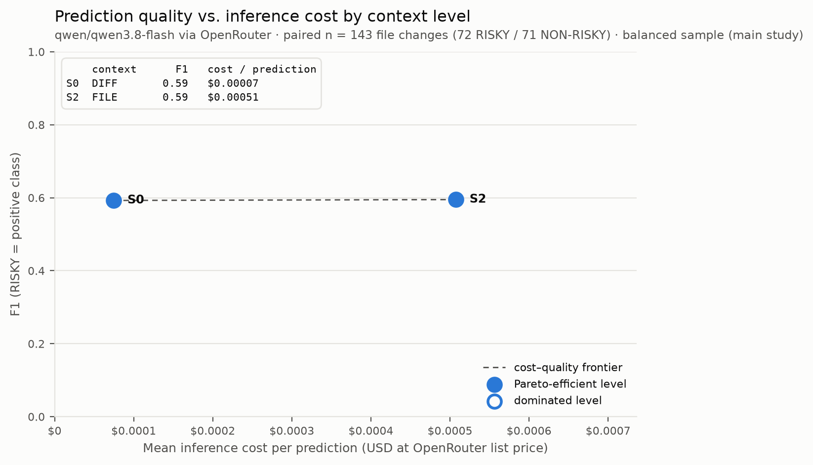

# Context level vs. LLM change-risk prediction — qwen/qwen3.8-flash (balanced sample, main study, identical re-run #2)

_Generated 2026-11-20T17:11:04+00:00 by `experiment.py report`. All numbers are computed from logged API responses._

## Setup

- **Data:** Defectors (Mahbub et al., MSR 2023), JIT split `time/test` (10,000 file changes: 1,246 RISKY / 8,754 NON-RISKY). Label = SZZ-derived defect-line annotation (paper's `induce_bug`, released as column `lines`): nonempty → RISKY, empty → NON-RISKY.
- **Sample:** 73 RISKY + 73 NON-RISKY single-file changes, seed 42, ≤1 file per commit; 1731 candidates examined in seeded order, 1585 excluded with logged reasons (modified `.py` file, non-merge commit, verified diff, parseable code, edits inside functions, BEFORE+AFTER ≤ 24,000 chars, diff ≤ 8,000 chars).
- **Model:** `qwen/qwen3.8-flash` via OpenRouter, provider pinned to `alibaba` (no fallbacks), temperature 0, max_tokens 256, reasoning/thinking disabled; one stateless request per prediction, in seeded random order (292 predictions).
- **Context levels (identical instruction and settings; only the context differs):**
  - **S0 DIFF** — the target-file diff
  - **S2 FILE** — S0 + the complete target file, BEFORE and AFTER

## Results (paired set: n = 143 cases with a valid prediction at every level)

| Level | Precision | Recall | F1 | Accuracy | TP / FP / TN / FN | Mean input tokens | Mean output tokens | Mean latency (s) | Mean cost (list price) | Mean charged | Total charged |
|---|---|---|---|---|---|---|---|---|---|---|---|
| S0 DIFF | 0.53 | 0.67 | **0.59** | 0.54 | 48 / 42 / 29 / 24 | 347 | 48.5 | 1.80 | $0.00007 | $0.00007 | $0.0107 |
| S2 FILE | 0.55 | 0.65 | **0.59** | 0.55 | 47 / 39 / 32 / 25 | 3,213 | 54.4 | 1.94 | $0.00051 | $0.00030 | $0.0432 |

### Trade-off against S0 DIFF

| Level | Cost per prediction | × cost of S0 | F1 [95% CI] | ΔF1 vs S0 [95% CI] | Correct | Fixed / broken vs S0 | Exact McNemar p | Extra cost per extra correct prediction | Pareto-efficient |
|---|---|---|---|---|---|---|---|---|---|
| S0 DIFF | $0.00007 | 1.0× | 0.59 [0.50, 0.68] | +0.00 | 77/143 | 0 / 0 | 1.00 | — | yes |
| S2 FILE | $0.00051 | 6.8× | 0.59 [0.50, 0.68] | +0.00 [-0.04, +0.05] | 79/143 | 8 / 6 | 0.79 | $0.0309 | yes |

_Trade-off costs use list price (input and output tokens × OpenRouter's per-token price), so that incidental provider-side caching cannot make a level look cheaper; actual charges are under spending._

**Sensitivity — all valid predictions per level** (not restricted to cases valid at every level): S0 F1 0.59 / accuracy 0.54 (n = 143); S2 F1 0.59 / accuracy 0.55 (n = 145).

**RQ1 — quality.** F1 by level: S0 0.59, S2 0.59. Highest: S2 (0.59). Correct predictions: S0 77/143, S2 79/143. Relative to S0, no level's case-level difference reaches p < 0.05 (exact McNemar); with n = 143 these differences are descriptive, not a statistically established ranking.

**RQ2 — trade-off.** Cost per prediction ranges from $0.00007 (S0) to $0.00051 (S2), a 7× spread driven by input length. Pareto-efficient levels (no other level is at least as good and cheaper): S0, S2; along that frontier S0 → S2: F1 0.59 → 0.59 for 6.8× the cost. The best trade-off is the frontier point where the extra F1 is still worth its extra cost; given the sample size, F1 gaps of one or two cases should not drive that choice on their own.

## Examples where more context changed the outcome

_Correctness is judged only against the reference label; explanations are quoted model output, not evidence._

**case031 — context helped (S2 vs S0).** `getsentry/sentry` · `src/sentry/integrations/github/client.py` · commit `be0f10bfb9` · reference **NON-RISKY**

- S0 DIFF: RISKY ✗ — “The change removes the try/except block that handled AttributeError, potentially causing an unhandled exception if scope.span is None or lacks expected attributes in certain Sentry SDK versions or contexts.”
- S2 FILE: NON-RISKY ✓ — “The change replaces a broad try/except AttributeError with an explicit None check for scope.span, which is functionally equivalent and safer as it avoids masking other potential AttributeErrors.”

**case048 — context helped (S2 vs S0).** `home-assistant/core` · `homeassistant/components/yalexs_ble/__init__.py` · commit `eea4719544` · reference **NON-RISKY**

- S0 DIFF: RISKY ✗ — “The new callback calls `push_lock.reset_advertisement_state()` which may not exist or may have different semantics, potentially causing an AttributeError or incorrect state reset when the device becomes unavailable.”
- S2 FILE: NON-RISKY ✓ — “The change adds a callback to reset advertisement state when the device becomes unavailable, which is a standard pattern for handling Bluetooth connectivity loss and does not introduce functional defects.”

**case004 — context hurt (S2 vs S0).** `home-assistant/core` · `homeassistant/components/wled/light.py` · commit `a8f1cc0d33` · reference **NON-RISKY**

- S0 DIFF: NON-RISKY ✓ — “Calling async_add_entities with an empty list is a safe no-op in Home Assistant, so removing the conditional check does not introduce functional defects.”
- S2 FILE: RISKY ✗ — “Removing the check for non-empty new_entities before calling async_add_entities may cause unnecessary overhead or potential errors in Home Assistant's entity platform if called with an empty list, although typically harmless, it changes behavior from conditional to unconditional invocation.”

## Reference: other models on the same frozen sample

_Each model's own paired set; not a head-to-head test._

| Model | Level | Paired n | F1 | Accuracy | Mean cost |
|---|---|---|---|---|---|
| claude-haiku-4.5 | S0 DIFF | 128 | 0.60 | 0.61 | $0.00075 |
| claude-haiku-4.5 | S1 FUNCTION | 128 | 0.52 | 0.55 | $0.00187 |
| claude-haiku-4.5 | S2 FILE | 128 | 0.54 | 0.54 | $0.00417 |
| claude-haiku-4.5 | S3 CALLERS | 128 | 0.55 | 0.57 | $0.00252 |
| claude-haiku-4.5 | S4 CALLEES | 128 | 0.55 | 0.57 | $0.00250 |
| claude-haiku-4.5 | N2 NOISE | 128 | 0.60 | 0.59 | $0.00431 |
| claude-haiku-4.5 | M0 MESSAGE | 128 | 0.53 | 0.59 | $0.00086 |
| claude-haiku-4.5_rep2 | S0 DIFF | 145 | 0.61 | 0.60 | $0.00075 |
| claude-haiku-4.5_rep2 | S2 FILE | 145 | 0.55 | 0.54 | $0.00427 |
| claude-sonnet-4.6 | S0 DIFF | 140 | 0.54 | 0.55 | $0.00223 |
| claude-sonnet-4.6 | S1 FUNCTION | 140 | 0.59 | 0.59 | $0.00561 |
| claude-sonnet-4.6 | S2 FILE | 140 | 0.61 | 0.61 | $0.0128 |
| claude-sonnet-4.6 | S3 CALLERS | 140 | 0.60 | 0.59 | $0.00766 |
| claude-sonnet-4.6 | S4 CALLEES | 140 | 0.58 | 0.58 | $0.00746 |
| claude-sonnet-4.6 | N2 NOISE | 140 | 0.61 | 0.61 | $0.0132 |
| claude-sonnet-4.6 | M0 MESSAGE | 140 | 0.57 | 0.61 | $0.00248 |
| gemini-2.5-flash-lite | S0 DIFF | 137 | 0.53 | 0.60 | $0.00006 |
| gemini-2.5-flash-lite | S1 FUNCTION | 137 | 0.48 | 0.55 | $0.00016 |
| gemini-2.5-flash-lite | S2 FILE | 137 | 0.39 | 0.53 | $0.00038 |
| gemini-2.5-flash-lite | S3 CALLERS | 137 | 0.43 | 0.53 | $0.00023 |
| gemini-2.5-flash-lite | S4 CALLEES | 137 | 0.46 | 0.55 | $0.00023 |
| gemini-2.5-flash-lite | S5 REPO | 137 | 0.53 | 0.53 | $0.0665 |
| gemini-2.5-flash-lite_ai-studio | S0 DIFF | 146 | 0.49 | 0.60 | $0.00006 |
| gemini-2.5-flash-lite_ai-studio | S1 FUNCTION | 146 | 0.46 | 0.57 | $0.00016 |
| gemini-2.5-flash-lite_ai-studio | S2 FILE | 146 | 0.40 | 0.55 | $0.00039 |
| gemini-2.5-flash-lite_ai-studio | S3 CALLERS | 146 | 0.41 | 0.54 | $0.00023 |
| gemini-2.5-flash-lite_ai-studio | S4 CALLEES | 146 | 0.41 | 0.54 | $0.00023 |
| gemini-2.5-flash-lite_ai-studio | N2 NOISE | 146 | 0.48 | 0.53 | $0.00040 |
| gemini-2.5-flash-lite_ai-studio | M0 MESSAGE | 146 | 0.32 | 0.56 | $0.00006 |
| gemini-2.5-flash-lite_ai-studio_rep2 | S0 DIFF | 146 | 0.49 | 0.60 | $0.00006 |
| gemini-2.5-flash-lite_ai-studio_rep2 | S2 FILE | 146 | 0.40 | 0.55 | $0.00039 |
| qwen3.8-flash | S0 DIFF | 131 | 0.58 | 0.54 | $0.00008 |
| qwen3.8-flash | S1 FUNCTION | 131 | 0.61 | 0.60 | $0.00022 |
| qwen3.8-flash | S2 FILE | 131 | 0.58 | 0.56 | $0.00051 |
| qwen3.8-flash | S3 CALLERS | 131 | 0.60 | 0.59 | $0.00030 |
| qwen3.8-flash | S4 CALLEES | 131 | 0.62 | 0.61 | $0.00031 |
| qwen3.8-flash | N2 NOISE | 131 | 0.61 | 0.61 | $0.00053 |
| qwen3.8-flash | M0 MESSAGE | 131 | 0.61 | 0.60 | $0.00009 |

## Failures and spending

| Level | Valid | Invalid output | Failed | Not run | Attempts (all) | Charged, all attempts |
|---|---|---|---|---|---|---|
| S0 | 143 | 3 | 0 | 0 | 146 | $0.0109 |
| S2 | 145 | 1 | 0 | 0 | 146 | $0.0448 |

- **Actual charges for this model (OpenRouter `usage.cost`), all 293 logged attempts incl. 1 preflight check(s) and 0 retries: $0.0557.** Attempts with unknown cost: 0. Project total across all models: $23.4570.
- 71 request(s) were billed partly at the provider's cache-read rate (case108/S2: 3,584 cached tokens, case010/S2: 1,024 cached tokens, case048/S2: 1,792 cached tokens, case076/S2: 1,792 cached tokens, case110/S2: 3,584 cached tokens, case137/S2: 1,792 cached tokens, case131/S2: 1,792 cached tokens, case019/S2: 3,584 cached tokens, case031/S2: 4,096 cached tokens, case135/S2: 3,584 cached tokens, case033/S2: 3,072 cached tokens, case037/S2: 1,792 cached tokens, case121/S2: 1,792 cached tokens, case067/S2: 1,792 cached tokens, case097/S2: 5,376 cached tokens, case138/S2: 3,584 cached tokens, case005/S2: 3,072 cached tokens, case057/S2: 3,584 cached tokens, case103/S2: 4,096 cached tokens, case145/S2: 5,376 cached tokens, case146/S2: 1,792 cached tokens, case026/S2: 1,792 cached tokens, case081/S2: 3,584 cached tokens, case039/S2: 3,584 cached tokens, case011/S2: 1,792 cached tokens, case124/S2: 3,584 cached tokens, case077/S2: 5,376 cached tokens, case098/S2: 1,792 cached tokens, case095/S2: 1,792 cached tokens, case144/S2: 1,024 cached tokens, case118/S2: 1,792 cached tokens, case054/S2: 1,792 cached tokens, case004/S2: 4,096 cached tokens, case052/S2: 5,376 cached tokens, case066/S2: 3,584 cached tokens, case050/S2: 3,584 cached tokens, case014/S2: 1,792 cached tokens, case065/S2: 5,376 cached tokens, case113/S2: 5,376 cached tokens, case079/S2: 5,376 cached tokens, case044/S2: 3,584 cached tokens, case015/S2: 3,584 cached tokens, case139/S2: 3,584 cached tokens, case012/S2: 7,168 cached tokens, case034/S2: 1,792 cached tokens, case126/S2: 3,584 cached tokens, case064/S2: 3,584 cached tokens, case073/S2: 5,376 cached tokens, case088/S2: 3,584 cached tokens, case133/S2: 5,376 cached tokens, case112/S2: 1,792 cached tokens, case022/S2: 3,584 cached tokens, case083/S2: 3,584 cached tokens, case086/S2: 1,792 cached tokens, case027/S2: 1,792 cached tokens, case107/S2: 3,584 cached tokens, case013/S2: 3,584 cached tokens, case111/S2: 3,584 cached tokens, case030/S2: 1,792 cached tokens, case099/S2: 3,584 cached tokens, case085/S2: 1,792 cached tokens, case127/S2: 1,792 cached tokens, case009/S2: 3,328 cached tokens, case016/S2: 3,584 cached tokens, case059/S2: 1,792 cached tokens, case068/S2: 1,792 cached tokens, case143/S2: 3,584 cached tokens, case041/S2: 3,584 cached tokens, case060/S2: 1,792 cached tokens, case056/S2: 1,792 cached tokens, case063/S2: 1,792 cached tokens), e.g. when a retry re-sent an identical prompt; charges include that discount, list-price costs do not.
- Pre-run estimate (kept separate from charges): $0.1210; worst case $0.1961; project budget cap used by the paid run $26.00.
- Run 20261120T155553Z: key-level usage change $0.055710 vs. sum of per-request charges $0.055710 → reconciled at end of run.

## Caveats

- **Balanced sample** (73 RISKY / 73 NON-RISKY). The split's natural prevalence is about 12% RISKY, so precision in particular does not generalize.
- **Labels are automatically derived** (SZZ-based bug-inducing annotations with heuristic filtering) and can be noisy.
- **Restricted sample:** small files, function-internal edits, single modified files.
- **Both context content and input length change** between levels, so effects cannot be attributed to content alone.
- **No statistically established winner:** differences of a few cases on n = 143 are within sampling noise.
- The repositories are public, so the model may have seen this code during training.

## Files

- `results/main/qwen3.8-flash_rep2/results.csv` — per-case, per-level predictions joined with labels
- `results/main/qwen3.8-flash_rep2/summary.csv` — metrics, tokens, latency, cost and trade-off columns per level
- `results/main/qwen3.8-flash_rep2/cost_vs_f1.png` — cost vs. F1 plot
- `results/main/qwen3.8-flash_rep2/attempts.jsonl`, `raw/`, `prompts/` — full request/response log
- `data/prepared/manifest.csv`, `selection_log.csv`, `context_summary.json` — frozen sample, exclusions, context coverage
